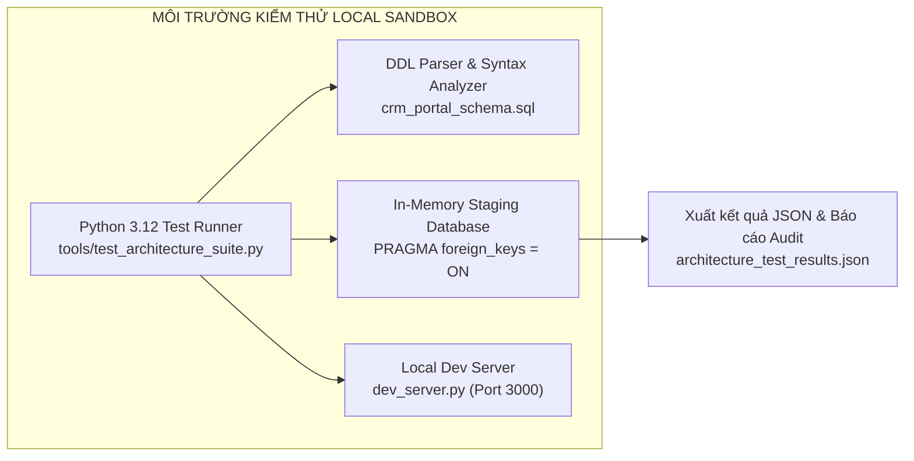

# KIPA VIỆT HÀN — KẾ HOẠCH KIỂM THỬ KIẾN TRÚC TỔNG THỂ (ARCHITECTURE TEST PLAN)

> **Tài liệu kiểm thử kiến trúc chuẩn:** Kế hoạch xác minh toàn diện Database, Nghiệp vụ, Luồng dữ liệu, Phân quyền và Bảo mật trước khi triển khai trên cPanel  
> **Phiên bản:** 1.0.0  
> **Chuyên trách:** Senior Database Architect, MySQL Engineer & Security Specialist  
> **Hệ sinh thái:** Website KIPA + KIPA CRM + KIPA Student Portal + LMS  
> **Môi trường thực hiện:** Local / Staging Sandbox (Tuyệt đối không chạy trên Production)  

---

## I. MỤC TIÊU VÀ NGUYÊN TẮC BẮT BUỘC

### 1. Mục tiêu kiểm thử
Xác minh tính khả thi, tính toàn vẹn dữ liệu, hiệu năng truy vấn, khả năng chống lỗi và mức độ an toàn thông tin của toàn bộ kiến trúc hệ sinh thái số KIPA trước khi thực hiện bất kỳ thao tác triển khai nào trên môi trường Production cPanel Hosting.

### 2. Bảy nguyên tắc bắt buộc tuyệt đối
1. **Chỉ làm việc trên môi trường Local hoặc Staging:** Toàn bộ quá trình chạy thử DDL, nạp dữ liệu mẫu và kiểm thử chức năng chỉ diễn ra trên bộ kiểm thử local sandbox.
2. **Không chạy SQL trên Production:** Không thực thi bất kỳ câu lệnh `CREATE`, `ALTER`, `DROP`, `INSERT`, `UPDATE`, `DELETE` nào trên database thật đang hoạt động.
3. **Không sửa dữ liệu Production:** Bảo toàn 100% dữ liệu thực tế của Website KIPA.
4. **Không DROP, TRUNCATE hoặc DELETE dữ liệu thật:** Bảo tồn nguyên trạng 5 bảng nền tảng (`kipa_leads`, `kipa_rate_limits`, `kipa_otp_codes`, `kipa_users`, `kipa_admins`).
5. **Không triển khai mã nguồn lên Hosting:** Không đưa mã nguồn đang kiểm thử lên production hosting khi chưa có biên bản nghiệm thu kiến trúc.
6. **Không tự ý thay đổi quyết định nghiệp vụ đã thống nhất:** Giữ vững pipeline tư vấn chuẩn KIPA, lịch làm việc mặc định T2-T7, 7 nhóm phê duyệt kép và cấu trúc phân quyền đã duyệt.
7. **Ghi nhận và Đề xuất minh bạch:** Mọi phát hiện về khoảng trống dữ liệu (gaps), thiếu bảng hoặc thiếu trường đều được ghi nhận vào Sổ đăng ký vấn đề (`ARCHITECTURE_ISSUES_REGISTER.md`) để xin ý kiến Ban Giám Đốc; tuyệt đối không tự ý áp đặt ngầm.

---

## II. PHẠM VI VÀ PHÂN BỔ 8 NHÓM KIỂM THỬ (KT01 – KT08)

Toàn bộ quá trình kiểm thử được chia thành **8 nhóm kiểm định độc lập**, bao gồm **40 Test Cases cụ thể**:

| Nhóm Kiểm Thử | Tên Nhóm Nghiệp Vụ | Trọng Tâm Đánh Giá Kỹ Thuật | Số Test Cases |
|---|---|---|:---:|
| **NHÓM KT01** | **Kiểm thử Database** | Kiểm kê bảng/View, PK/FK, Index B-Tree, Storage Engine InnoDB, Charset utf8mb4, chống trùng bảng CMS/CRM, kiểm tra ON DELETE/ON UPDATE, tính lũy đẳng (Idempotency) và sao lưu/khôi phục. | **5 TCs** |
| **NHÓM KT02** | **Website $\rightarrow$ CRM** | Mô phỏng gửi Form web, lưu Lead kèm UTM parameters, ánh xạ nguồn/chiến dịch, cơ chế Retry Webhook, chống trùng Lead (Idempotency Hash), kiểm toán bảo vệ Lead trong `cleanup.php` & `submit.php`. | **5 TCs** |
| **NHÓM KT03** | **Khách Hàng (Customer Master)** | Sinh mã khách hàng duy nhất `customer_code`, nhận diện khách hàng quay lại tái sử dụng mã cũ, 1 khách hàng sở hữu nhiều hồ sơ tư vấn, 1 khách hàng có nhiều hồ sơ dịch vụ, liên kết quan hệ nhân thân và cơ chế Merge khách hàng trùng. | **5 TCs** |
| **NHÓM KT04** | **Tư Vấn & Hồ Sơ Dịch Vụ** | Chuẩn hóa 8 trạng thái pipeline tư vấn KIPA, lưu vết lịch sử tương tác cuộc gọi/gặp mặt/Zalo, lịch hẹn kế tiếp, nhiều nhu cầu dịch vụ, quy trình Handover (từ chối $\rightarrow$ bổ sung $\rightarrow$ chấp thuận) và khởi tạo hồ sơ dịch vụ chính thức. | **5 TCs** |
| **NHÓM KT05** | **Phân Quyền & Quản Lý Nhân Sự** | Ma trận 6 cấp vai trò KIPA, cơ chế cộng dồn quyền (Cumulative RBAC), giới hạn phạm vi dữ liệu (Scope) theo Chi nhánh/Phòng ban, quản lý không mặc nhiên xem tài liệu nhạy cảm (`is_sensitive`), điều chuyển nhân sự, khóa tài khoản và ủy quyền. | **5 TCs** |
| **NHÓM KT06** | **Nhiệm Vụ, SLA & Quy Trình Phê Duyệt** | Phân công nhiệm vụ (giao việc, làm chính, phối hợp), cây nhiệm vụ con (`parent_id`), tính toán Deadline SLA theo lịch làm việc KIPA (T2-T6 8-17, T7 8-12, CN nghỉ), tạm dừng/tiếp tục SLA, leo thang vượt cấp, nghiệm thu KPI, Snapshot payload và chống tự duyệt. | **5 TCs** |
| **NHÓM KT07** | **Kho Tài Liệu Master Vault** | Tải lên tài liệu, quản lý đa phiên bản file scan/PDF, quy trình thẩm định & yêu cầu bổ sung, tách biệt quyền Xem và quyền Tải file (`can_download`), bảo mật đường dẫn ngoài webroot (`kipa-private/storage/`), nhật ký truy cập và bảo tồn khi đóng hồ sơ (RESTRICT). | **5 TCs** |
| **NHÓM KT08** | **Student Portal & Bảo Mật Chống IDOR** | Xác thực đăng nhập qua máy chủ, nạp Profile học viên, chuyển đổi nhiều hồ sơ trên giao diện, xem lộ trình 5 bước, tải lên tài liệu bổ sung, kiểm thử tấn công Insecure Direct Object Reference (IDOR) bằng kỹ thuật can thiệp ID request. | **5 TCs** |
| **TỔNG CỘNG** | **8 NHÓM KIỂM THỬ** | **Bao phủ 100% các yêu cầu kiến trúc và luồng dữ liệu KIPA** | **40 TCs** |

---

## III. MÔI TRƯỜNG KIỂM THỬ VÀ CÔNG CỤ TỰ ĐỘNG

1. **Bộ kiểm thử tự động (Automated Test Harness):** File script thực thi `tools/test_architecture_suite.py`.
2. **Cơ sở dữ liệu Staging nội bộ:** In-memory SQLite Sandbox với cờ `PRAGMA foreign_keys = ON` kích hoạt đầy đủ kiểm tra toàn vẹn quan hệ, mô phỏng chính xác hành vi của MySQL 8.0 InnoDB.
3. **Mã nguồn kiểm toán:**
   - DDL CRM & Portal: `crm_portal_schema.sql` và `backend/crm_portal_schema.sql`.
   - DDL CMS Staged: `backend/content-schema.sql`.
   - Mã nguồn Backend PHP Website: `api/submit.php`, `api/account.php`, `api/cleanup.php`, `api/bootstrap.php`, `api/admin.php`.
4. **Phân biệt phương pháp kiểm định:**
   - **EXECUTED TEST (Kiểm thử thực thi):** Bắt buộc chạy mã lệnh, thực thi câu truy vấn SQL thực tế, tính toán thuật toán, kích hoạt trigger/constraint và đối soát kết quả đầu ra.
   - **STATIC REVIEW (Đánh giá tĩnh):** Rà soát mã nguồn, phân tích cú pháp DDL và cấu trúc AST mà không qua bước thực thi động.

---

## IV. TIÊU CHÍ ĐÁNH GIÁ VÀ MỨC ĐỘ NGHIÊM TRỌNG

Mỗi test case khi thực hiện được đánh giá theo 3 trạng thái:
- **PASS (ĐẠT):** Kết quả thực tế khớp 100% với kết quả mong đợi, đáp ứng đầy đủ tiêu chuẩn kỹ thuật và nghiệp vụ KIPA.
- **FAIL (KHÔNG ĐẠT / PHÁT HIỆN GAP):** Kết quả thực tế không khớp, phát hiện thiếu bảng, thiếu trường, xung đột cú pháp hoặc vi phạm ràng buộc bảo mật.
- **BLOCKED (BỊ CHẶN):** Test case không thể thực thi do phụ thuộc vào một điều kiện tiên quyết trước đó bị thất bại.

Mức độ nghiêm trọng nếu thất bại (Severity Levels):
- **CRITICAL (Khẩn cấp / Chặn triển khai):** Gây mất mát dữ liệu, lộ lọt thông tin nhạy cảm (IDOR), sai lệch tài chính, xung đột khóa chính/khóa ngoại hoặc làm tê liệt website. Bắt buộc phải giải quyết triệt để trước khi ra Production.
- **HIGH (Cao):** Ảnh hưởng nghiêm trọng đến luồng vận hành (sai lệch pipeline, tính sai giờ SLA, thiếu bước duyệt kép), cần khắc phục trước khi golive.
- **MEDIUM (Trung bình):** Khoảng trống kiến trúc chưa hoàn chỉnh (thiếu bảng log retry webhook, thiếu bảng merge history), có thể tạm thời áp dụng workaround an toàn nhưng cần đưa vào kế hoạch nâng cấp.
- **LOW (Thấp):** Góp ý tối ưu hóa, chuẩn hóa tên gọi hoặc bổ sung tài liệu hướng dẫn.

---

## V. MA TRẬN 40 TEST CASES CHI TIẾT

```mermaid
graph TD
    subgraph KT01["KT01: Database (5)"]
        T01["TC-KT01-01: Kiểm kê bảng & View"]
        T02["TC-KT01-02: PK, FK, Engine, Type"]
        T03["TC-KT01-03: Chống trùng bảng CMS/CRM"]
        T04["TC-KT01-04: ON DELETE RESTRICT & SET NULL"]
        T05["TC-KT01-05: Idempotency & Backup"]
    end

    subgraph KT02["KT02: Website -> CRM (5)"]
        T06["TC-KT02-01: Lưu Lead & UTM"]
        T07["TC-KT02-02: Đồng bộ Lead Sources"]
        T08["TC-KT02-03: Retry Webhook Queue"]
        T09["TC-KT02-04: Deduplication Hash"]
        T10["TC-KT02-05: Bảo vệ Lead trong Cleanup"]
    end

    subgraph KT03["KT03: Khách Hàng (5)"]
        T11["TC-KT03-01: Cấp mã KH-YYYY-XXXX"]
        T12["TC-KT03-02: Khách quay lại dùng mã cũ"]
        T13["TC-KT03-03: 1 Khách nhiều Hồ sơ tư vấn"]
        T14["TC-KT03-04: 1 Khách nhiều Hồ sơ dịch vụ"]
        T15["TC-KT03-05: Nhân thân & Merge History"]
    end

    subgraph KT04["KT04: Tư Vấn & Hồ Sơ (5)"]
        T16["TC-KT04-01: Chuẩn hóa 8 mốc Pipeline"]
        T17["TC-KT04-02: Lịch sử tương tác & Lịch hẹn"]
        T18["TC-KT04-03: Nhiều nhu cầu dịch vụ"]
        T19["TC-KT04-04: Bàn giao & Trả lại bổ sung"]
        T20["TC-KT04-05: Chấp thuận bàn giao & Tạo HS"]
    end

    subgraph KT05["KT05: Phân Quyền RBAC (5)"]
        T21["TC-KT05-01: Quyền cộng dồn Multi-role"]
        T22["TC-KT05-02: Giới hạn Scope Chi nhánh"]
        T23["TC-KT05-03: Bảo vệ Tài liệu nhạy cảm"]
        T24["TC-KT05-04: Thu hồi quyền khi chuyển cơ sở"]
        T25["TC-KT05-05: Khóa tài khoản & Ủy quyền"]
    end

    subgraph KT06["KT06: Task & SLA (5)"]
        T26["TC-KT06-01: Phân công & Cây nhiệm vụ con"]
        T27["TC-KT06-02: Thuật toán SLA Lịch KIPA T2-T7"]
        T28["TC-KT06-03: Tạm dừng SLA & Leo thang"]
        T29["TC-KT06-04: Nghiệm thu hoàn thành KPI"]
        T30["TC-KT06-05: Snapshot & Chống tự duyệt"]
    end

    subgraph KT07["KT07: Document Vault (5)"]
        T31["TC-KT07-01: Đa phiên bản file scan"]
        T32["TC-KT07-02: Thẩm định & Yêu cầu bổ sung"]
        T33["TC-KT07-03: Tách biệt Xem và Tải file"]
        T34["TC-KT07-04: Đường dẫn ngoài webroot & Log"]
        T35["TC-KT07-05: Bảo tồn khi đóng hồ sơ (RESTRICT)"]
    end

    subgraph KT08["KT08: Student Portal (5)"]
        T36["TC-KT08-01: Auth Session & Profile Cache"]
        T37["TC-KT08-02: Chuyển đổi đa hồ sơ"]
        T38["TC-KT08-03: Truy vấn View kipa_student_documents"]
        T39["TC-KT08-04: Học viên upload bổ sung"]
        T40["TC-KT08-05: Kiểm thử tấn công IDOR Session"]
    end
```

Kế hoạch kiểm thử này đóng vai trò là kim chỉ nam kỹ thuật chuẩn mực để toàn bộ đội ngũ kỹ thuật KIPA và Hội đồng đánh giá đối soát từng mục kiểm thử độc lập.
