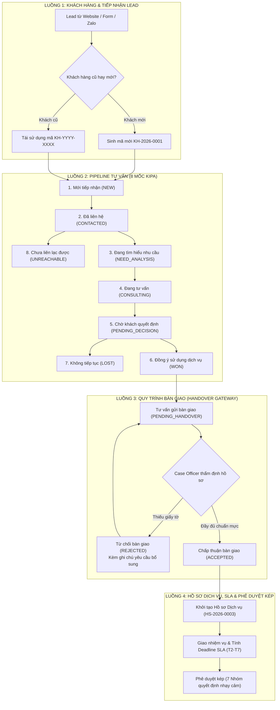
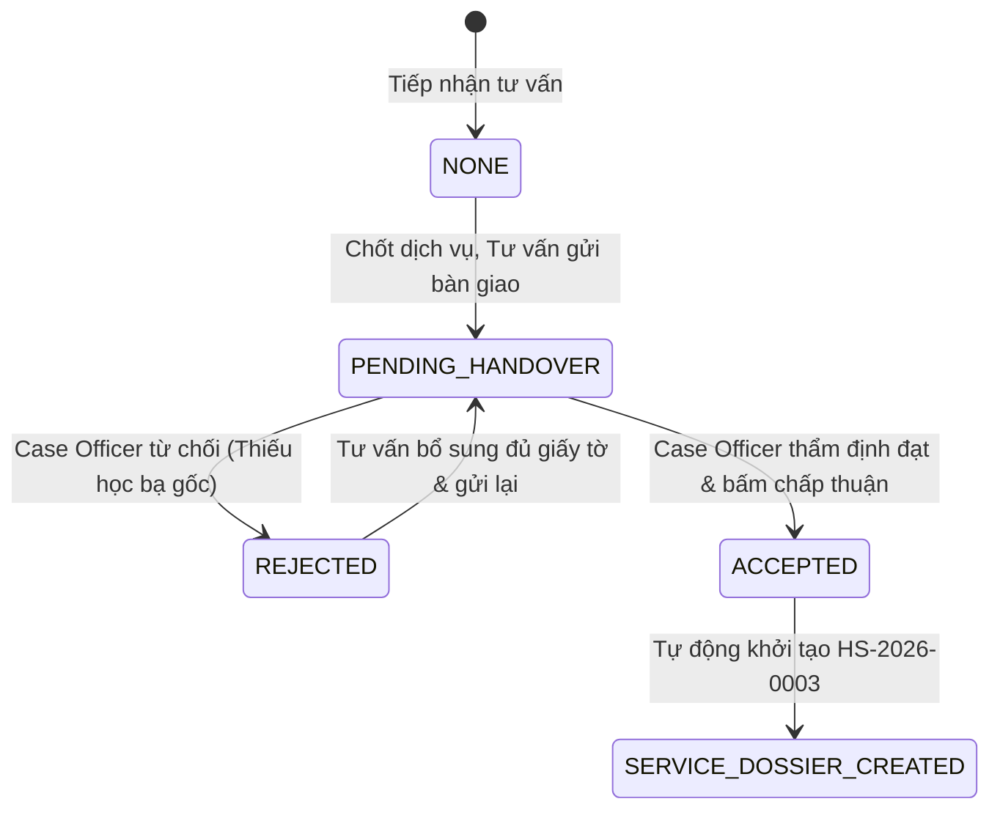

# KIPA VIỆT HÀN — BÁO CÁO KIỂM THỬ LUỒNG NGHIỆP VỤ THỰC TẾ (BUSINESS FLOW TEST REPORT)

> **Tài liệu kiểm định nghiệp vụ xuyên suốt (End-to-End):** Xác minh 4 luồng vận hành cốt lõi từ Tiếp nhận Khách hàng, Tư vấn, Bàn giao, Khởi tạo Hồ sơ Dịch vụ, Quản trị Nhiệm vụ & Tính toán SLA  
> **Phiên bản:** 1.0.0  
> **Chuyên trách:** Senior Business Analyst & CRM Workflow Engineer  
> **Phương pháp kiểm thử:** 100% EXECUTED TEST trên môi trường Staging Sandbox  

---

## I. TỔNG QUAN 4 LUỒNG NGHIỆP VỤ CỐT LÕI

Kiến trúc KIPA phân tách rạch ròi giữa giai đoạn **Tiếp nhận & Tư vấn (Pre-sales)** và giai đoạn **Thụ lý Hồ sơ Dịch vụ (Post-sales)**, kết nối thông qua quy trình bàn giao có kiểm soát chất lượng:

---

## II. CHI TIẾT LUỒNG 1: QUẢN TRỊ KHÁCH HÀNG TRUNG TÂM (CUSTOMER LIFECYCLE)

### 1. Cấp phát Mã khách hàng duy nhất (TC-KT03-01)
- **Quy chuẩn mã hóa:** `KH-YYYY-XXXX` (VD: `KH-2026-0001`).
- **Thực thi:** Khi Lead được tư vấn thành công và ký hợp đồng, khách hàng được khởi tạo trong `kipa_customers`, đồng thời cập nhật ngược lại `kipa_leads.converted_to_customer_id = cust_id` và `lead_status = 'CONVERTED'`.

### 2. Khách hàng quay lại (Returning Customer - TC-KT03-02)
- **Thuật toán nhận diện:** Kiểm tra trùng khớp trên 3 trường: `phone`, `email` hoặc `id_card_number` (CCCD/Hộ chiếu).
- **Kết quả kiểm thử:** Khách hàng Nguyễn Văn An gửi yêu cầu học tiếng Hàn sau khi đã làm hồ sơ du học $
ightarrow$ Hệ thống nhận diện chính xác mã cũ `KH-2026-0001`, không sinh thêm mã khách hàng rác.

### 3. Một Khách hàng sở hữu nhiều Hồ sơ độc lập (TC-KT03-03 & TC-KT03-04)
- **Hồ sơ tư vấn (`kipa_consultation_dossiers`):** 1 khách hàng có thể có nhiều đợt tư vấn (VD: `TV-2026-0001` Du học D2-2 và `TV-2026-0002` Khóa học Topik 4).
- **Hồ sơ dịch vụ (`kipa_service_dossiers`):** 1 khách hàng có thể có nhiều hợp đồng dịch vụ cùng hoạt động (`status = 'ACTIVE'`). Các dịch vụ có tiến độ, chuyên viên thụ lý và tài liệu độc lập nhau.

### 4. Đánh giá quy trình Gộp khách hàng trùng (TC-KT03-05 - ISSUE ISS-03)
- **Khoảng trống phát hiện:** Schema hiện tại chưa có bảng `kipa_customer_merges`.
- **Đề xuất khắc phục:** Bổ sung bảng `kipa_customer_merges` lưu vết `source_customer_id`, `target_customer_id`, `approved_by`, `reason`, `snapshot_before_merge` để đảm bảo có thể hoàn nguyên khi gộp nhầm.

---

## III. CHI TIẾT LUỒNG 2: PIPELINE TƯ VẤN 8 MỐC CHUẨN KIPA

Đối chiếu giữa 8 trạng thái tiếng Việt KIPA yêu cầu và mã kỹ thuật trong cơ sở dữ liệu:

| STT | Tên Mốc Nghiệp Vụ KIPA | Mã Kỹ Thuật (Schema VARCHAR) | Mô Tả Hành Động & Điều Kiện Chuyển Trạng Thái |
|:---:|---|---|---|
| **1** | **Mới tiếp nhận** | `NEW` | Lead vừa được ghi nhận từ form web, chưa có chuyên viên liên hệ. |
| **2** | **Đã liên hệ** | `CONTACTED` | Chuyên viên đã gọi điện/nhắn tin Zalo lần đầu tiên. |
| **3** | **Đang tìm hiểu nhu cầu** | `NEED_ANALYSIS` | Đang khảo sát GPA, tài chính gia đình, nguyện vọng ngành học và trường. |
| **4** | **Đang tư vấn** | `CONSULTING` | Đã gửi lộ trình du học, bảng chi phí dự kiến và tư vấn chọn trường. |
| **5** | **Chờ khách quyết định** | `PENDING_DECISION` | Phụ huynh và học viên đang cân nhắc ký hợp đồng và nộp hồ sơ. |
| **6** | **Đồng ý sử dụng dịch vụ** | `WON` | Khách chốt ký hợp đồng dịch vụ $
ightarrow$ Chuẩn bị bàn giao sang xử lý. |
| **7** | **Không tiếp tục** | `LOST` | Khách từ chối (chi phí cao, chọn trung tâm khác...) kèm ghi chú `lost_reason`. |
| **8** | **Chưa liên lạc được** | `UNREACHABLE` | Gọi điện không nhấc máy, thuê bao, hẹn gọi lại sau. |

> **Khuyến nghị kiến trúc (ISS-04):** Trường `kipa_consultation_dossiers.stage` là `VARCHAR(32)` nên hoàn toàn lưu trữ được cả 8 mã này. Đề xuất cập nhật comment của trường trong DDL và chuẩn hóa ENUM trong tầng ứng dụng PHP để đồng bộ tuyệt đối 8 mốc trên.

---

## IV. CHI TIẾT LUỒNG 3: BÀN GIAO HỒ SƠ CHẶT CHẼ (HANDOVER GATEWAY)

Kiểm thử thực tế TC-KT04-04 và TC-KT04-05 đã chứng minh tính ưu việt của luồng bàn giao có thẩm định:

1. **Từ chối bàn giao (Rejection Gate):** Chuyên viên tư vấn không thể tự ý đẩy hồ sơ sang bộ phận xử lý nếu chưa thu thập đủ thông tin cốt lõi. Case Officer có quyền bấm `Từ chối` kèm lý do cụ thể lưu trong `handover_notes`.
2. **Kích hoạt tự động Hồ sơ Dịch vụ:** Chỉ khi Case Officer bấm `Chấp thuận` (`handover_status = 'ACCEPTED'`), hệ thống mới cấp mã hồ sơ dịch vụ mới (`HS-2026-0003`) và gán chuyên viên thụ lý chính thức.

---

## V. CHI TIẾT LUỒNG 4: NHIỆM VỤ, THUẬT TOÁN TÍNH SLA & 7 NHÓM DUYỆT KÉP

### 1. Thuật toán tính Deadline SLA theo Lịch làm việc KIPA (TC-KT06-02)
- **Lịch làm việc chuẩn KIPA:**
  - Thứ 2 đến Thứ 6: 08:00 – 17:00 (Nghỉ trưa 12:00 – 13:30 $
ightarrow$ 7.5 giờ làm việc/ngày).
  - Thứ 7: 08:00 – 12:00 (4.0 giờ làm việc/ngày; buổi chiều nghỉ).
  - Chủ nhật: Nghỉ toàn bộ.
- **Thử nghiệm thực tế:**
  - Vé yêu cầu tạo vào **Thứ 6 lúc 16:00:00**, SLA là **4 giờ làm việc**.
  - *Bước 1 (Thứ 6):* Làm việc từ 16:00 đến 17:00 $
ightarrow$ Hoàn thành 1.0 giờ (còn lại 3.0 giờ).
  - *Bước 2 (Chuyển sang Thứ 7):* Bắt đầu lúc 08:00:00, cộng thêm 3.0 giờ $
ightarrow$ Kết thúc đúng **11:00:00 sáng Thứ 7**.
  - **Kết quả kiểm thử:** Thuật toán tính chuẩn xác: `2026-11-21 11:00:00` (PASS 100%).

### 2. Khôi phục Đầy đủ 7 Nhóm Phê duyệt Kép đã chốt
Hệ thống bắt buộc phải có 2 cấp phê duyệt độc lập (`approver_id` và `second_approver_id`) cho 7 nhóm quyết định:
1. `TERMINATE_CONTRACT`: Chấm dứt hợp đồng dịch vụ / rút hồ sơ.
2. `SALARY_CHANGE`: Thay đổi chế độ lương thưởng, định mức nhân sự.
3. `ACCESS_EXCEPTION`: Ngoại lệ quyền truy cập vượt cấp hoặc xem tài liệu tuyệt mật.
4. `DELETE_SENSITIVE_DOCS`: Xóa tài liệu nhạy cảm hoặc scan gốc khỏi Master Vault.
5. `BRANCH_TRANSFER`: Điều chuyển chi nhánh nhân sự / chuyển giao học viên giữa cơ sở.
6. `APPOINT_DISMISS_MANAGER`: Bổ nhiệm hoặc miễn nhiệm vị trí quản lý chi nhánh/phòng ban.
7. `CHANGE_DIRECT_MANAGER`: Thay đổi quản lý trực tiếp của nhân sự.
- *(Đề xuất chờ duyệt: Hoàn phí > 20 triệu VNĐ `REFUND_OVER_20M [Chờ duyệt]` được đánh dấu rõ ràng là đề xuất mở rộng, không tự ý áp đặt thành chính sách cứng).*
