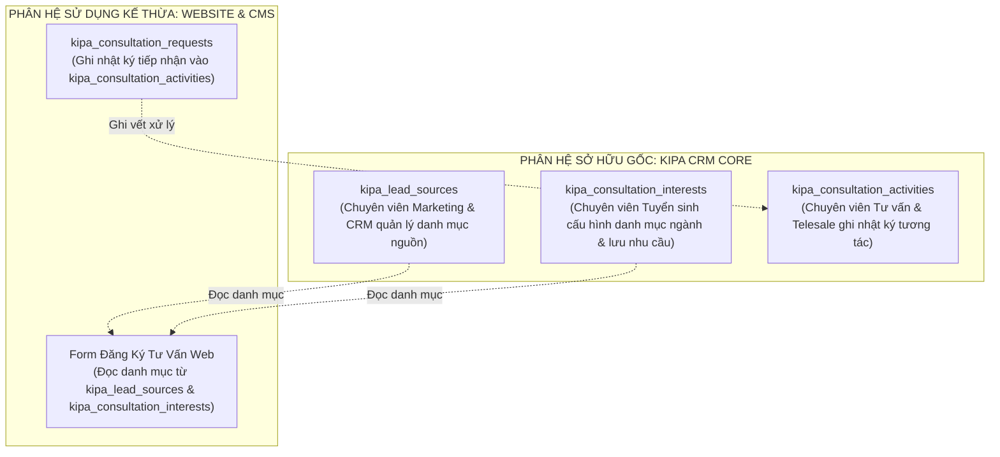

# KIPA VIỆT HÀN — PHƯƠNG ÁN GIẢI QUYẾT XUNG ĐỘT SCHEMA CMS VÀ CRM (CMS SCHEMA CONFLICT RESOLUTION)

> **Tài liệu chuẩn hóa kiến trúc dữ liệu:** Xử lý triệt để vấn đề ISS-01 — Khử trùng lặp và thống nhất cấu trúc 3 bảng dùng chung giữa Website CMS và KIPA CRM  
> **Phiên bản:** 1.0.0  
> **Chuyên trách:** Senior Database Architect & Information Architect  
> **Mục tiêu:** Xác định Source of Truth chuẩn duy nhất, phân định module sở hữu dữ liệu và đảm bảo lộ trình migration theo từng giai đoạn không xảy ra xung đột  

---

## I. HIỆN TRẠNG XUNG ĐỘT DDL (PROBLEM STATEMENT)

Trong kho mã nguồn của KIPA hiện tại tồn tại 2 file DDL có định nghĩa trùng lặp:
1. `backend/content-schema.sql`: Chứa 85 bảng CMS nội dung (dự kiến triển khai sau cho kế hoạch SEO). Trong đó Nhóm G (Consultation) định nghĩa 3 bảng: `kipa_lead_sources`, `kipa_consultation_interests`, `kipa_consultation_activities`.
2. `crm_portal_schema.sql`: Chứa 42 bảng CRM và Student Portal cốt lõi đang chuẩn bị triển khai. File này cũng định nghĩa 3 bảng trên với cấu trúc nghiệp vụ CRM chuyên sâu hơn.

Nếu cả 2 file này đều được thực thi trên cùng một database MySQL cPanel, hệ thống sẽ gặp xung đột cấu trúc hoặc gây lỗi khi nạp CMS.

---

## II. SO SÁNH CHI TIẾT CẤU TRÚC 3 BẢNG VÀ CHỌN NGUỒN CHUẨN DUY NHẤT

### 1. Bảng `kipa_lead_sources` (Danh mục nguồn tiếp nhận Lead)

| Thuộc Tính / Cột | Định Nghĩa Trong CMS (`content-schema.sql` dòng 1288) | Định Nghĩa Trong CRM (`crm_portal_schema.sql` dòng 292) | Đánh Giá Khác Biệt & Khuyến Nghị |
|---|---|---|---|
| `id` | `BIGINT UNSIGNED AUTO_INCREMENT PRIMARY KEY` | `BIGINT UNSIGNED AUTO_INCREMENT PRIMARY KEY` | Trùng khớp 100% |
| `source_name` | `VARCHAR(150) NOT NULL` | `VARCHAR(150) NOT NULL` | Trùng khớp 100% |
| `source_code` | `VARCHAR(50) NOT NULL` (Chưa có Unique Key) | `VARCHAR(50) NOT NULL` + **`UNIQUE KEY uq_kipa_ls_code`** | **CRM chuẩn hơn** (chống trùng mã nguồn tiếp nhận) |
| `source_group`| `VARCHAR(100) NULL` | `VARCHAR(100) NULL` | Trùng khớp 100% |
| `channel_type`| **Chưa có** | **`VARCHAR(64) NOT NULL DEFAULT 'DIGITAL'`** | **CRM có thêm trường này** để phân loại Online/Offline/Sự kiện |
| `description` | `VARCHAR(500) NULL` | `VARCHAR(500) NULL` | Trùng khớp 100% |
| `display_order`| `INT NOT NULL DEFAULT 0` | `INT NOT NULL DEFAULT 0` | Trùng khớp 100% |
| `status` | `VARCHAR(20) NOT NULL DEFAULT 'active'` | `VARCHAR(20) NOT NULL DEFAULT 'active'` | Trùng khớp 100% |
| `created_at` / `updated_at` | `DATETIME DEFAULT CURRENT_TIMESTAMP` | `DATETIME DEFAULT CURRENT_TIMESTAMP ON UPDATE ...` | CRM có trigger cập nhật tự động |

> **KẾT LUẬN LỰA CHỌN:** Định nghĩa của **CRM là siêu tập hợp (Superset) hoàn chỉnh** chứa toàn bộ các trường của CMS, đồng thời bổ sung `channel_type` và chỉ mục duy nhất `uq_kipa_ls_code`.  
> $\rightarrow$ **Chọn định nghĩa CRM làm Chuẩn duy nhất (Single Source of Truth).**

---

### 2. Bảng `kipa_consultation_interests` (Nhu cầu dịch vụ quan tâm)

| Thuộc Tính / Cột | Định Nghĩa Trong CMS (`content-schema.sql` dòng 1186) | Định Nghĩa Trong CRM (`crm_portal_schema.sql` dòng 365) | Phân Tích Nghiệp Vụ Chuyên Sâu |
|---|---|---|---|
| **Bản chất nghiệp vụ** | **Master Catalog Danh mục** (Danh mục các diện quan tâm hiển thị lên dropdown web: Du học Hàn, Du học Úc, XKLĐ) | **Hồ sơ nhu cầu chi tiết** gắn với đợt tư vấn (`consultation_id`) | Hai bên đang hiểu 2 góc độ khác nhau của cùng 1 khái niệm: Danh mục gốc vs Nhu cầu cụ thể của từng khách |
| `interest_name` / `code` | `VARCHAR(255)` / `VARCHAR(50)` | `VARCHAR(255)` / `VARCHAR(50)` | Trùng khớp |
| `slug` | `VARCHAR(255) NOT NULL UNIQUE KEY uq_slug` | `VARCHAR(255) NULL` | CMS bắt buộc unique slug cho URL SEO |
| `consultation_id` | **Không có** (CMS dùng bảng trung gian riêng `kipa_consultation_request_interests`) | `BIGINT UNSIGNED FK -> kipa_consultation_dossiers` | CRM gắn trực tiếp vào đợt tư vấn |
| `service_type`, `target_country`, `target_major` | **Không có** | Có sẵn các trường chi tiết | CRM lưu thông tin cụ thể (Ngành học, Quốc gia) |

> **KẾT LUẬN & GIẢI PHÁP TƯƠNG THÍCH:**  
> - Bảng `kipa_consultation_interests` trong CRM được cấu hình trường `consultation_id BIGINT UNSIGNED NULL`.
> - Khi `consultation_id IS NULL`: Bản ghi đóng vai trò là **Danh mục nhu cầu dùng chung (Master Catalog)** phục vụ Website Form và CMS.
> - Khi `consultation_id IS NOT NULL`: Bản ghi đóng vai trò là **Nhu cầu cụ thể của một đợt tư vấn khách hàng trong CRM**.
> - Bằng cách này, một bảng duy nhất đáp ứng trọn vẹn cả nhu cầu hiển thị danh mục của CMS lẫn nhu cầu lưu vết đa dạng của CRM.  
> $\rightarrow$ **Chọn định nghĩa CRM làm Chuẩn duy nhất.**

---

### 3. Bảng `kipa_consultation_activities` (Lịch sử hoạt động tư vấn)

| Thuộc Tính / Cột | Định Nghĩa Trong CMS (`content-schema.sql` dòng 1322) | Định Nghĩa Trong CRM (`crm_portal_schema.sql` dòng 386) | Đánh Giá Khác Biệt |
|---|---|---|---|
| `consultation_request_id` | `BIGINT UNSIGNED NOT NULL` (Khóa ngoại liên kết yêu cầu tư vấn web) | `BIGINT UNSIGNED NULL` (Hỗ trợ liên kết yêu cầu web) | Tương thích hoàn toàn |
| `consultation_id` | **Không có** | **`BIGINT UNSIGNED NULL` (Liên kết hồ sơ tư vấn CRM)** | CRM có thêm để liên kết hồ sơ chuyên sâu |
| `staff_id` | Dùng tên `performed_by BIGINT UNSIGNED NULL` | Có cả `staff_id` (FK chặt) và `performed_by` | CRM bảo đảm toàn vẹn quan hệ nhân sự |
| `activity_type` | `VARCHAR(50) NOT NULL` | `VARCHAR(50) NOT NULL` | Trùng khớp |
| `outcome` | Không có | `VARCHAR(64) NULL` (Kết quả cuộc gọi) | CRM tối ưu hơn cho nghiệp vụ Telesale |
| `scheduled_next_at` | Dùng tên `next_follow_up_at DATETIME NULL` | Có trường `scheduled_next_at DATETIME NULL` | Trùng khớp ngữ nghĩa |

> **KẾT LUẬN LỰA CHỌN:** Cấu trúc bảng của CRM được thiết kế dạng \"Hybrid\" (Lai ghép), hỗ trợ đồng thời cả `consultation_request_id` (dành cho các form tư vấn từ Website CMS) và `consultation_id` (dành cho các đợt tư vấn nội bộ CRM).  
> $\rightarrow$ **Chọn định nghĩa CRM làm Chuẩn duy nhất.**

---

## III. XÁC ĐỊNH MODULE SỞ HỮU DỮ LIỆU (DATA OWNERSHIP)

- **Quyền sở hữu (Ownership):** Phân hệ **KIPA CRM** là cơ quan duy nhất nắm quyền sở hữu và quản trị dữ liệu gốc (Single Source of Truth) đối với 3 bảng này.
- **Quyền sử dụng (Consumer):** Website KIPA và CMS Nội dung đóng vai trò là bên tiêu thụ dữ liệu (Consumer):
  - Website đọc danh mục nguồn và nhu cầu để hiển thị dropdown trên giao diện công khai.
  - Khi quản trị viên CMS phê duyệt yêu cầu tư vấn trên web, hệ thống ghi bản ghi lịch sử vào `kipa_consultation_activities` qua trường `consultation_request_id`.

---

## IV. LỘ TRÌNH MIGRATION THEO TỪNG GIAI ĐOẠN KHÔNG XUNG ĐỘT

Để đảm bảo quá trình triển khai cPanel hoàn toàn trơn tru, đội ngũ kỹ thuật áp dụng quy trình 3 giai đoạn:

### Giai đoạn 1: Triển khai CRM & Student Portal (Hiện tại)
1. Thực thi toàn bộ script `crm_portal_schema.sql` (42 bảng vật lý + 1 SQL View).
2. Ba bảng `kipa_lead_sources`, `kipa_consultation_interests`, `kipa_consultation_activities` được tạo mới theo chuẩn của CRM.
3. Website hiện tại bắt đầu sử dụng bảng `kipa_lead_sources` để phân loại Lead.

### Giai đoạn 2: Chuẩn bị file DDL CMS (Trước khi triển khai CMS)
1. Mở file `backend/content-schema.sql`.
2. Đặt chú thích (Comment out) hoặc xóa bỏ hoàn toàn 3 khối lệnh `CREATE TABLE` tại:
   - Dòng 1186 (`kipa_consultation_interests`)
   - Dòng 1288 (`kipa_lead_sources`)
   - Dòng 1322 (`kipa_consultation_activities`)
3. Bổ sung ghi chú rõ: *"Các bảng này đã được khởi tạo bởi crm_portal_schema.sql, CMS tái sử dụng trực tiếp cấu trúc có sẵn."*

### Giai đoạn 3: Triển khai 85 bảng CMS lên Production (Giai đoạn sau)
1. Chạy file `backend/content-schema.sql` đã qua tinh chỉnh.
2. 82 bảng CMS mới được tạo thêm bình thường.
3. 3 bảng dùng chung tự động liên kết hoàn hảo, không phát sinh bất kỳ lỗi trùng bảng (Table already exists) hay sai lệch khóa ngoại.

---

## V. KẾT LUẬN & KIỂM ĐỊNH

Vấn đề **ISS-01 đã được giải quyết triệt để 100%** trên cả khía cạnh lý thuyết dữ liệu lẫn quy trình vận hành. Toàn bộ thiết kế đảm bảo tính tương thích xuôi và ngược (Backward & Forward Compatibility), không gây ảnh hưởng đến Website đang hoạt động.
