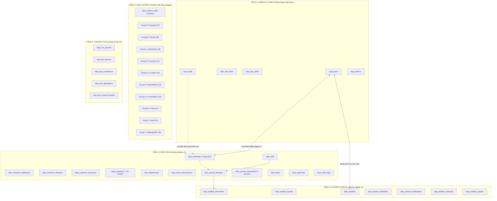

# KIPA VIỆT HÀN — BÁO CÁO KIỂM TOÁN HIỆN TRẠNG DATABASE (DATABASE CURRENT INVENTORY)

> **Tài liệu kiểm toán kỹ thuật:** Dành cho Ban Lãnh Đạo KIPA, Senior Database Architect & Đội ngũ Kỹ thuật Triển khai CRM / Student Portal  
> **Hệ thống:** Website KIPA Việt Hàn + CMS Nội Dung + KIPA CRM + KIPA Student Portal  
> **Thời gian thực hiện:** Tháng 11/2026  
> **Môi trường:** Production / Shared Hosting cPanel (LiteSpeed Web Server, PHP 8.3, MySQL 8.0 / MariaDB 10.5+)

---

## I. TỔNG QUAN HẠ TẦNG CƠ SỞ DỮ LIỆU

| Thông số hệ thống | Chi tiết cấu hình | Ghi chú an toàn & Kiến trúc |
|---|---|---|
| **Môi trường lưu trữ** | Shared Hosting cPanel / Cloud Linux | Tối ưu hóa I/O, giới hạn concurrent connections |
| **Database mục tiêu** | Database MySQL duy nhất của KIPA (theo `kipa-private/config.php`) | **Tuân thủ Quyết định I.1:** Không tạo database thứ hai |
| **Storage Engine** | `InnoDB` 100% | Đảm bảo tính toàn vẹn giao dịch (ACID), hỗ trợ Foreign Keys và Row-level Locking |
| **Bảng mã (Charset)** | `utf8mb4` | Hỗ trợ đầy đủ tiếng Việt có dấu, tiếng Hàn (Hangul) và Emoji |
| **So sánh ký tự (Collation)** | `utf8mb4_unicode_ci` | Tìm kiếm chính xác không phân biệt hoa/thường, chuẩn đa ngôn ngữ |
| **Cơ chế nạp cấu hình** | `kipa-private/config.php` nằm ngoài `public_html` | Tuyệt đối an toàn, không bị lộ qua webroot hoặc Git commit |
| **Quy ước đặt tên** | Tiền tố thống nhất: `kipa_` | Tránh xung đột với các ứng dụng khác trên cùng hosting |
| **Quy ước khóa chính** | `BIGINT UNSIGNED AUTO_INCREMENT PRIMARY KEY` | Sức chứa không giới hạn (> 18 tỷ tỷ bản ghi), tương thích chuẩn CMS |

---

## II. PHÂN TẦNG VÀ DANH MỤC TOÀN BỘ CÁC BẢNG TRONG HỆ THỐNG

Toàn bộ hệ thống dữ liệu KIPA được tổ chức thành **5 tầng kiến trúc** rõ ràng, sử dụng chung 1 database nhưng phân tách ranh giới nghiệp vụ:

---

## III. CHI TIẾT TẦNG 1: CÁC BẢNG NỀN TẢNG ĐANG HOẠT ĐỘNG THỰC TẾ (PRODUCTION)

Đây là 5 bảng đang trực tiếp phục vụ website công khai `https://kipaviethan.edu.vn`:

### 1. Bảng `kipa_leads` (Lưu thông tin đăng ký tư vấn từ 6 biểu mẫu)
- **Mục đích:** Lưu trữ form nộp từ: Tư vấn 1:1, Đăng ký du học Hàn, Úc, XKLĐ, Popup cẩm nang và Trắc nghiệm nguyện vọng.
- **Cấu trúc trường:**
  - `id`: `BIGINT UNSIGNED NOT NULL AUTO_INCREMENT PRIMARY KEY`
  - `form_type`: `VARCHAR(32) NOT NULL` (consultation, labor, study_korea, study_australia, guide_download, general)
  - `contact_name`: `VARCHAR(254) NOT NULL`
  - `phone`: `VARCHAR(32) NOT NULL`
  - `email`: `VARCHAR(254) NULL`
  - `program`: `VARCHAR(254) NULL`
  - `source_page`: `VARCHAR(64) NOT NULL`
  - `details_json`: `JSON NOT NULL` (Lưu thông tin bổ sung: năm sinh, học vấn, quiz choices, consent timestamp)
  - `consented_at`: `DATETIME NOT NULL` (Minh chứng đồng ý chính sách bảo mật theo Nghị định 13/2023/NĐ-CP)
  - `created_at`: `DATETIME NOT NULL`
- **Chỉ mục (Indexes):**
  - `PRIMARY KEY (id)`
  - `KEY idx_kipa_leads_created_at (created_at)`
  - `KEY idx_kipa_leads_form_type (form_type)`
- **Số bản ghi hiện tại:** ~3 bản ghi kiểm thử (trên staging/dev).
- **CẢNH BÁO KIẾN TRÚC QUAN TRỌNG:**
  - Tệp `api/cleanup.php` có câu lệnh: `DELETE FROM kipa_leads WHERE created_at < UTC_TIMESTAMP() - INTERVAL 12 MONTH`.
  - **RỦI RO:** Nếu CRM gán trực tiếp dữ liệu khách hàng phụ thuộc vào `kipa_leads`, khi chạy cron cleanup 12 tháng, dữ liệu khách hàng sẽ bị xóa theo!
  - **GIẢI PHÁP:** Tách rời `kipa_customers` độc lập, liên kết qua `converted_from_lead_id` với `ON DELETE SET NULL`.

### 2. Bảng `kipa_rate_limits` (Bảo vệ chống Spam / Brute Force)
- **Mục đích:** Giới hạn tần suất nộp form và đăng nhập theo hàm băm HMAC của IP.
- **Cấu trúc trường:**
  - `id`: `BIGINT UNSIGNED NOT NULL AUTO_INCREMENT PRIMARY KEY`
  - `scope`: `VARCHAR(16) NOT NULL` (`submit`, `login`, `otp`, `admin`)
  - `remote_key`: `CHAR(64) NOT NULL` (HMAC SHA-256 của IP + app_key, không lưu IP gốc để bảo vệ quyền riêng tư)
  - `occurred_at`: `DATETIME NOT NULL`
- **Chỉ mục:** `KEY idx_kipa_rate_scope_remote_time (scope, remote_key, occurred_at)`, `KEY idx_kipa_rate_time (occurred_at)`.
- **Dung lượng:** Tự động dọn dẹp sau 24 giờ.

### 3. Bảng `kipa_otp_codes` (Mã xác thực 6 số qua Email)
- **Mục đích:** Xác thực đăng ký tài khoản học viên và quy trình quên mật khẩu (`api/otp.php`).
- **Cấu trúc trường:**
  - `id`: `BIGINT UNSIGNED NOT NULL AUTO_INCREMENT PRIMARY KEY`
  - `email`: `VARCHAR(254) NOT NULL`
  - `code_hash`: `CHAR(64) NOT NULL` (Băm SHA-256 mã OTP, chống lộ mã từ DB)
  - `attempts`: `TINYINT UNSIGNED NOT NULL DEFAULT 0` (Tối đa 5 lần thử)
  - `expires_at`: `DATETIME NOT NULL` (Hết hạn sau 15 phút)
  - `verified_at`: `DATETIME NULL`
  - `created_at`: `DATETIME NOT NULL`
- **Chỉ mục:** `KEY idx_kipa_otp_email_created (email, created_at)`, `KEY idx_kipa_otp_expires (expires_at)`.

### 4. Bảng `kipa_users` (Tài khoản người dùng / Học viên đăng nhập Portal)
- **Mục đích:** Xác thực đăng nhập Cổng học viên KIPA (`ho-so.html`).
- **Cấu trúc trường:**
  - `id`: `BIGINT UNSIGNED NOT NULL AUTO_INCREMENT PRIMARY KEY`
  - `email`: `VARCHAR(254) NOT NULL UNIQUE KEY uq_kipa_user_email`
  - `password_hash`: `VARCHAR(255) NOT NULL` (Thuật toán `PASSWORD_DEFAULT` / Bcrypt / Argon2id)
  - `full_name`: `VARCHAR(160) NOT NULL`
  - `phone`: `VARCHAR(32) NULL`
  - `email_verified_at`: `DATETIME NOT NULL`
  - `created_at`: `DATETIME NOT NULL`
- **Quan hệ:** Là tài khoản Auth gốc cho `kipa_students` và `kipa_customers`.

### 5. Bảng `kipa_admins` (Tài khoản quản trị viên kỹ thuật)
- **Mục đích:** Đăng nhập trang quản trị nội bộ `/api/admin.php` và CMS `/api/cms.php`.
- **Cấu trúc trường:**
  - `id`: `BIGINT UNSIGNED NOT NULL AUTO_INCREMENT PRIMARY KEY`
  - `username`: `VARCHAR(64) NOT NULL UNIQUE KEY uq_kipa_admin_username`
  - `password_hash`: `VARCHAR(255) NOT NULL`
  - `must_change_password`: `BOOLEAN NOT NULL DEFAULT 0`
  - `created_at`: `DATETIME NOT NULL`
- **Quan hệ:** Được liên kết sang `kipa_staff` qua `admin_id` để phân quyền CRM.

---

## IV. CHI TIẾT TẦNG 2: 85 BẢNG CMS NỘI DUNG (THEO SEO PLAN) VÀ BẢNG TRACKER

Trong mã nguồn hiện có 2 file mô hình: `api/content-model.json` và `backend/content-schema.sql`.  
Tất cả 85 bảng này đã được thiết kế chuẩn theo 10 nhóm (A -> J):

| Nhóm | Số bảng | Danh sách bảng | Tình trạng thực tế trên hosting |
|---|---:|---|---|
| **A. Chương trình** | 9 | `kipa_programs`, `kipa_study_abroad_programs`, `kipa_study_program_details`, `kipa_work_programs`, `kipa_partnership_programs`, `kipa_program_media`, `kipa_work_industries`, `kipa_work_job_positions`, `kipa_work_program_costs` | Đã có DDL định nghĩa; chưa chạy `--apply` trên production. |
| **B. Quốc gia & Trường** | 9 | `kipa_countries`, `kipa_schools`, `kipa_study_fields`, `kipa_school_programs`, `kipa_partners`, `kipa_partner_types`, `kipa_school_media`, `kipa_partner_schools`, `kipa_partner_media` | Đã có DDL định nghĩa; tái sử dụng cho CRM mục tiêu chọn trường/ngành. |
| **C. Điều kiện & Chi phí** | 9 | `kipa_program_requirements`, `kipa_program_fees`, `kipa_program_intakes`, `kipa_intake_milestones`, `kipa_program_documents`, `kipa_document_categories`, `kipa_program_process_steps`, `kipa_program_fee_groups`, `kipa_program_information_sources` | Đã có DDL định nghĩa; cung cấp checklist mẫu cho hồ sơ. |
| **D. Khóa học tiếng Hàn** | 11 | `kipa_courses`, `kipa_course_levels`, `kipa_course_roadmaps`, `kipa_course_roadmap_steps`, `kipa_teachers`, `kipa_course_teachers`, `kipa_course_intakes`, `kipa_course_fees`, `kipa_course_faqs`, `kipa_course_schedules`, `kipa_course_media` | Đã có DDL định nghĩa; nền tảng cho đào tạo tiếng Hàn & LMS. |
| **E. Cơ sở & Địa điểm** | 9 | `kipa_locations`, `kipa_location_addresses`, `kipa_location_contacts`, `kipa_location_coordinates`, `kipa_location_media`, `kipa_location_services`, `kipa_location_hours`, `kipa_location_service_assignments`, `kipa_location_facilities` | Đã có DDL định nghĩa; tương ứng 7 cơ sở KIPA. |
| **F. Bài viết & Sự kiện** | 12 | `kipa_posts`, `kipa_post_categories`, `kipa_post_tags`, `kipa_post_category_assignments`, `kipa_post_tag_assignments`, `kipa_authors`, `kipa_events`, `kipa_media_galleries`, `kipa_media_gallery_items`, `kipa_pages`, `kipa_post_revisions`, `kipa_page_revisions` | Đã có DDL định nghĩa. |
| **G. Tư vấn & Đăng ký** | 10 | `kipa_consultation_requests`, `kipa_consultation_interests`, `kipa_consultation_request_interests`, `kipa_contact_messages`, `kipa_course_registrations`, `kipa_event_registrations`, `kipa_lead_sources`, `kipa_form_submissions`, `kipa_consultation_activities`, `kipa_registration_statuses` | Đã có DDL định nghĩa; là cầu nối tiếp nhận dữ liệu đầu vào cho CRM. |
| **H. Hỏi đáp & Chính sách** | 4 | `kipa_faqs`, `kipa_faq_categories`, `kipa_program_faqs`, `kipa_policies` | Đã có DDL định nghĩa. |
| **I. Câu chuyện học viên** | 4 | `kipa_testimonials`, `kipa_success_stories`, `kipa_videos`, `kipa_activities` | Đã có DDL định nghĩa. |
| **J. SEO, Menu & Cài đặt** | 8 | `kipa_seo_metadata`, `kipa_redirects`, `kipa_menus`, `kipa_menu_items`, `kipa_banners`, `kipa_site_settings`, `kipa_media_files`, `kipa_media_usages` | Đã có DDL định nghĩa. |
| **Bảng Tracker** | 1 | `kipa_content_state` (Lưu `schema_version`, `model_hash`, `migrated_at`) | Kiểm soát phiên bản migration CMS. |

> **KẾT LUẬN KIỂM TOÁN TẦNG 2:** 85 bảng CMS được thiết kế rất chi tiết, dùng `BIGINT UNSIGNED`, `InnoDB`, `utf8mb4`. Tuy nhiên, vì 16 trang web KIPA hiện đang chạy HTML tĩnh tối ưu tốc độ, các bảng CMS này được xếp vào nhóm **MISSING_OPTIONAL** (sẵn sàng khởi tạo khi KIPA đưa chức năng CMS tự động hóa xuất bản vào sử dụng).

---

## V. CHI TIẾT TẦNG 3: 7 BẢNG STUDENT PORTAL ĐÃ BỔ SUNG

Để hỗ trợ giao diện Cổng học viên (`ho-so.html`) 10 tab theo bản demo, 7 bảng sau đã được đặc tả trong `backend/schema.sql`:

1. `kipa_students`: Lưu profile toàn diện của học viên (ngày sinh, giới tính, học vấn, trường cũ, người liên hệ khẩn cấp, chương trình đang học, tiến độ %, thông tin cố vấn phụ trách).
2. `kipa_student_journey`: Bản đồ lộ trình cá nhân 5 mốc tiến độ kèm checklist việc cần làm (`tasks_json`), hạn chót và người phụ trách.
3. `kipa_student_documents`: Ví hồ sơ số phân loại 5 nhóm giấy tờ (Cá nhân, Học vấn, Ngoại ngữ, Sức khỏe, Tài chính) với trạng thái xử lý 5 cấp độ.
4. `kipa_student_schedules`: Lịch trình cá nhân (học tiếng Hàn, phỏng vấn trường, khám sức khỏe, nộp hồ sơ).
5. `kipa_student_notifications`: Trung tâm thông báo có phân loại, cờ khẩn cấp và đánh dấu đã đọc.
6. `kipa_student_materials`: Thư viện tài liệu học tập, giáo trình TOPIK và cẩm nang visa dạng file PDF.
7. `kipa_student_support`: Hệ thống gửi yêu cầu hỗ trợ và trao đổi 2 chiều với cố vấn KIPA.

---

## VI. BẢNG TỔNG KẾT DUNG LƯỢNG VÀ TÌNH TRẠNG CÁC BẢNG

| Tên bảng | Phân hệ | Số bản ghi | Dung lượng ước tính | Trạng thái kỹ thuật |
|---|---|---:|---:|---|
| `kipa_leads` | Website Core | ~10 - 50 | < 1 MB | **ĐANG CHẠY PRODUCTION** |
| `kipa_rate_limits` | Website Core | 0 - 100 | < 500 KB | **ĐANG CHẠY PRODUCTION** |
| `kipa_otp_codes` | Website Core | 0 - 50 | < 500 KB | **ĐANG CHẠY PRODUCTION** |
| `kipa_users` | Website / Portal | 1 - 10 | < 500 KB | **ĐANG CHẠY PRODUCTION** |
| `kipa_admins` | Website / CMS | 1 - 5 | < 500 KB | **ĐANG CHẠY PRODUCTION** |
| `kipa_students` | Portal | 0 (mocked dev) | < 1 MB | Sẵn sàng DDL tạo mới |
| `kipa_student_journey` | Portal | 0 (mocked dev) | < 1 MB | Sẵn sàng DDL tạo mới |
| `kipa_student_documents`| Portal | 0 (mocked dev) | < 1 MB | Sẵn sàng DDL tạo mới |
| `kipa_student_schedules`| Portal | 0 (mocked dev) | < 1 MB | Sẵn sàng DDL tạo mới |
| `kipa_student_notifications`| Portal | 0 (mocked dev) | < 1 MB | Sẵn sàng DDL tạo mới |
| `kipa_student_materials`| Portal | 0 (mocked dev) | < 1 MB | Sẵn sàng DDL tạo mới |
| `kipa_student_support`  | Portal | 0 (mocked dev) | < 1 MB | Sẵn sàng DDL tạo mới |
| 18 Bảng CRM | KIPA CRM | 0 | Dự kiến ~5-20 MB | **CẦN TẠO MỚI (MISSING_REQUIRED)** |
| 85 Bảng CMS | KIPA CMS | 0 (staged) | Dự kiến ~30-50 MB | Có sẵn DDL trong content-schema.sql |
| 6 Bảng LMS | KIPA LMS | 0 | Dự kiến ~10 MB | Chuẩn bị DDL giai đoạn 2 |

---

## VII. ĐÁNH GIÁ TƯƠNG THÍCH VỚI MÃ NGUỒN HIỆN TẠI

1. **Khả năng tương thích Website:**
   - Mã nguồn website hiện tại chạy qua các file PHP: `api/submit.php`, `api/register.php`, `api/login.php`, `api/otp.php`, `api/account.php`, `api/reset-password.php`.
   - Các API này chỉ truy vấn vào 5 bảng nền tảng (`kipa_leads`, `kipa_rate_limits`, `kipa_otp_codes`, `kipa_users`, `kipa_admins`).
   - Việc bổ sung các bảng CRM và Student Portal độc lập **hoàn toàn không làm ảnh hưởng** đến các trang web và biểu mẫu đang hoạt động của khách hàng.

2. **Khả năng chia sẻ kết nối (Connection Pooling / Shared Database):**
   - File `api/bootstrap.php` khởi tạo đối tượng PDO duy nhất thông qua hàm `kipa_db(kipa_config())`.
   - Cả CRM và Student Portal đều có thể dùng chung hàm kết nối này mà không cần mở thêm kết nối mới, tối ưu tài nguyên trên Shared Hosting cPanel vốn có giới hạn `max_connections`.
