# KIPA VIỆT HÀN — BÁO CÁO KIỂM TOÁN HIỆN TRẠNG DATABASE (DATABASE CURRENT INVENTORY)

> **Tài liệu kiểm toán kỹ thuật:** Dành cho Ban Lãnh Đạo KIPA, Senior Database Architect & Đội ngũ Kỹ thuật Triển khai CRM / Student Portal  
> **Phiên bản:** 2.1.0 (Kiểm toán & Chuẩn hóa cuối cùng trước khi deploy cPanel)  
> **Hệ thống:** Website KIPA Việt Hàn + CMS Nội Dung + KIPA CRM + KIPA Student Portal + KIPA LMS  
> **Môi trường:** Production / Shared Hosting cPanel (LiteSpeed Web Server, PHP 8.3, MySQL 8.0 / MariaDB 10.5+)

---

## I. TỔNG QUAN HẠ TẦNG CƠ SỞ DỮ LIỆU

| Thông số hệ thống | Chi tiết cấu hình | Ghi chú an toàn & Kiến trúc |
|---|---|---|
| **Môi trường lưu trữ** | Shared Hosting cPanel / Cloud Linux | Tối ưu hóa I/O, giới hạn concurrent connections |
| **Database mục tiêu** | Database MySQL duy nhất của KIPA (theo `kipa-private/config.php`) | **Tuân thủ Quyết định I.1:** Sử dụng chung 1 database duy nhất, không tạo database thứ hai |
| **Storage Engine** | `InnoDB` 100% | Đảm bảo tính toàn vẹn giao dịch (ACID), hỗ trợ Foreign Keys và Row-level Locking |
| **Bảng mã (Charset)** | `utf8mb4` | Hỗ trợ đầy đủ tiếng Việt có dấu, tiếng Hàn (Hangul) và Emoji |
| **So sánh ký tự (Collation)** | `utf8mb4_unicode_ci` | Tìm kiếm chính xác không phân biệt hoa/thường, chuẩn đa ngôn ngữ |
| **Cơ chế nạp cấu hình** | `kipa-private/config.php` nằm ngoài `public_html` | Tuyệt đối an toàn, không bị lộ qua webroot hoặc Git commit |
| **Quy ước đặt tên** | Tiền tố thống nhất: `kipa_` | Tránh xung đột với các ứng dụng khác trên cùng hosting |
| **Quy ước khóa chính** | `BIGINT UNSIGNED AUTO_INCREMENT PRIMARY KEY` | Sức chứa không giới hạn (> 18 tỷ tỷ bản ghi), tương thích chuẩn CMS |

---

## II. PHÂN TẦNG VÀ DANH MỤC TOÀN BỘ CÁC BẢNG TRONG HỆ THỐNG

Toàn bộ hệ thống dữ liệu KIPA được tổ chức thành **5 tầng kiến trúc** rõ ràng, sử dụng chung 1 database duy nhất nhưng phân tách ranh giới nghiệp vụ:

```mermaid
graph TD
    subgraph T1["TẦNG 1: WEBSITE CORE (5 bảng đang hoạt động thực tế)"]
        L["kipa_leads (Leads từ Form Web)"]
        R["kipa_rate_limits (Chống Spam / Brute Force)"]
        O["kipa_otp_codes (Xác thực Email OTP)"]
        U["kipa_users (Tài khoản học viên Auth)"]
        A["kipa_admins (Tài khoản quản trị kỹ thuật)"]
    end

    subgraph T2["TẦNG 2: WEBSITE CMS (85 bảng Staged + 1 Tracker)"]
        CMS["kipa_content_state (Tracker)"]
        GrA["Group A: Programs (9)"]
        GrB["Group B: Schools (9)"]
        GrC["Group C: Admissions (9)"]
        GrD["Group D: Courses (11)"]
        GrE["Group E: Locations (9)"]
        GrF["Group F: Posts/Media (12)"]
        GrG["Group G: Consultation (10)"]
        GrH["Group H: FAQs (4)"]
        GrI["Group I: Proofs (4)"]
        GrJ["Group J: Settings/SEO (8)"]
    end

    subgraph T3["TẦNG 3: KIPA CRM (21 bảng tạo mới)"]
        BR["kipa_branches (7 Chi nhánh/VPĐD)"]
        DEP["kipa_departments (Phòng ban)"]
        TEAM["kipa_teams (Nhóm chuyên môn)"]
        STAFF["kipa_staff (Hồ sơ nhân sự)"]
        ROLE["kipa_roles & kipa_permissions"]
        SROLE["kipa_staff_roles (Phân quyền & hạn tạm)"]
        DELEG["kipa_role_delegations (Ủy quyền nghỉ phép)"]
        CUST["kipa_customers (Hồ sơ khách hàng trung tâm)"]
        CADDR["kipa_customer_addresses (Sổ địa chỉ)"]
        CREL["kipa_customer_relations (Quan hệ thân nhân)"]
        CEDU["kipa_customer_education (Học vấn & GPA)"]
        DOS["kipa_service_dossiers (Hồ sơ dịch vụ)"]
        ASSIGN["kipa_dossier_assignments (Phân công & CTV)"]
        SHIST["kipa_dossier_status_history (Tạm dừng/Lưu trữ)"]
        TASK["kipa_tasks (Công việc, SLA, nhắc hạn)"]
        APP["kipa_approvals (Phê duyệt nhiều cấp)"]
        LOG["kipa_audit_logs (Nhật ký kiểm toán)"]
        DDOC["kipa_dossier_documents (Kho tài liệu gốc)"]
        DVER["kipa_document_versions (Phiên bản tài liệu)"]
        DREV["kipa_document_reviews (Thẩm định tài liệu)"]
    end

    subgraph T4["TẦNG 4: KIPA STUDENT PORTAL (7 bảng + 1 View)"]
        STUD["kipa_students (Profile Cache học viên)"]
        JOUR["kipa_student_journey (Lộ trình 5 bước)"]
        SCHED["kipa_student_schedules (Lịch học & hẹn)"]
        NOTIF["kipa_student_notifications (Thông báo)"]
        MAT["kipa_student_materials (Thư viện PDF)"]
        SUPP["kipa_student_support (Kênh yêu cầu hỗ trợ)"]
        NSET["kipa_notification_settings (Cài đặt thông báo)"]
        V_DOC["VIEW kipa_student_documents (Ánh xạ ví hồ sơ số)"]
    end

    subgraph T5["TẦNG 5: KIPA LMS ĐÀO TẠO (6 bảng chuẩn bị)"]
        LMS_C["kipa_lms_classes (Lớp tiếng Hàn)"]
        LMS_L["kipa_lms_lessons (Buổi học)"]
        LMS_E["kipa_lms_enrollments (Ghi danh)"]
        LMS_A["kipa_lms_attendance (Điểm danh)"]
        LMS_EX["kipa_lms_exams & grades (Thi & Điểm)"]
    end

    L -.->|Chuyển đổi Lead thành Khách hàng| CUST
    U <-->|Tài khoản Auth 1-1| CUST
    U <-->|Đăng nhập Cổng học viên| STUD
    CUST --> DOS
    DOS --> DDOC
    DDOC --> DVER
    DVER --> DREV
    DDOC -.->|Hợp nhất tham chiếu| V_DOC
    STAFF --> DOS
    DOS --> JOUR
```

---

## III. CHI TIẾT TẦNG 1: CÁC BẢNG NỀN TẢNG ĐANG HOẠT ĐỘNG THỰC TẾ (PRODUCTION)

Đây là 5 bảng đang trực tiếp phục vụ website công khai `https://kipaviethan.edu.vn`:

### 1. Bảng `kipa_leads` (Lưu thông tin đăng ký tư vấn từ 6 biểu mẫu)
- **Mục đích:** Lưu trữ form nộp từ: Tư vấn 1:1, Đăng ký du học Hàn, Úc, XKLĐ, Popup cẩm nang và Trắc nghiệm nguyện vọng.
- **Cấu trúc trường hiện tại:**
  - `id`: `BIGINT UNSIGNED NOT NULL AUTO_INCREMENT PRIMARY KEY`
  - `form_type`: `VARCHAR(32) NOT NULL` (consultation, labor, study_korea, study_australia, guide_download, general)
  - `contact_name`: `VARCHAR(254) NOT NULL`
  - `phone`: `VARCHAR(32) NOT NULL`
  - `email`: `VARCHAR(254) NULL`
  - `program`: `VARCHAR(254) NULL`
  - `source_page`: `VARCHAR(64) NOT NULL`
  - `details_json`: `JSON NOT NULL` (Lưu thông tin bổ sung: năm sinh, học vấn, quiz choices, consent timestamp)
  - `consented_at`: `DATETIME NOT NULL` (Minh chứng đồng ý chính sách bảo mật theo Nghị định 13/2023/NĐ-CP)
  - `created_at`: `DATETIME NOT NULL`
- **Chỉ mục:** `PRIMARY KEY (id)`, `KEY idx_kipa_leads_created_at (created_at)`, `KEY idx_kipa_leads_form_type (form_type)`.
- **Số bản ghi hiện tại:** ~3 bản ghi kiểm thử.
- **CẢNH BÁO KIẾN TRÚC & PHƯƠNG ÁN BẢO VỆ:**
  - File `api/cleanup.php` có câu lệnh: `DELETE FROM kipa_leads WHERE created_at < UTC_TIMESTAMP() - INTERVAL 12 MONTH`.
  - Nếu CRM tham chiếu trực tiếp với `ON DELETE CASCADE`, khi cron chạy dọn lead cũ sau 12 tháng, hồ sơ khách hàng sẽ bị xóa theo!
  - **Phương án chuẩn hóa:** Bổ sung trường `converted_to_customer_id` vào `kipa_leads`. Thiết lập khóa ngoại `kipa_customers.legacy_lead_id` là `ON DELETE SET NULL`. Cập nhật `api/cleanup.php` chỉ dọn lead rác chưa chuyển đổi thành khách hàng.

### 2. Bảng `kipa_rate_limits` (Bảo vệ chống Spam / Brute Force)
- **Mục đích:** Giới hạn tần suất nộp form và đăng nhập theo hàm băm HMAC của IP.
- **Cấu trúc trường:** `id`, `scope` (submit, login, otp, admin), `remote_key` (HMAC SHA-256 IP), `occurred_at`.
- **Dung lượng & Dọn dẹp:** Tự động dọn dẹp sau 24 giờ qua cronjob. Giữ nguyên 100%.

### 3. Bảng `kipa_otp_codes` (Mã xác thực 6 số qua Email)
- **Mục đích:** Xác thực đăng ký tài khoản học viên và quy trình quên mật khẩu (`api/otp.php`).
- **Cấu trúc trường:** `id`, `email`, `code_hash`, `attempts` (tối đa 5 lần), `expires_at` (15 phút), `verified_at`, `created_at`.
- **Đánh giá:** Đạt chuẩn bảo mật, dùng chung cho Website và Cổng học viên.

### 4. Bảng `kipa_users` (Tài khoản người dùng / Học viên đăng nhập Portal)
- **Mục đích:** Xác thực đăng nhập Cổng học viên KIPA (`ho-so.html`).
- **Cấu trúc trường hiện tại:** `id`, `email` (UNIQUE), `password_hash` (Bcrypt/Argon2id), `full_name`, `phone`, `email_verified_at`, `created_at`.
- **Mở rộng an toàn:** Bổ sung `avatar_url` (VARCHAR 255 NULL), `is_active` (BOOLEAN DEFAULT 1), `last_login_at` (DATETIME NULL).

### 5. Bảng `kipa_admins` (Tài khoản quản trị viên kỹ thuật)
- **Mục đích:** Đăng nhập trang quản trị nội bộ `/api/admin.php` và CMS `/api/cms.php`.
- **Cấu trúc trường:** `id`, `username` (UNIQUE), `password_hash`, `must_change_password`, `created_at`.
- **Đánh giá:** Giữ nguyên 100%, liên kết sang `kipa_staff` qua khóa ngoại `admin_id`.

---

## IV. CHI TIẾT TẦNG 2: 85 BẢNG CMS NỘI DUNG VÀ 1 BẢNG TRACKER

Trong mã nguồn hiện có 2 file mô hình: `api/content-model.json` và `backend/content-schema.sql`. Toàn bộ 85 bảng này đã được thiết kế chuẩn theo 10 nhóm (A -> J):

| Nhóm | Số bảng | Danh mục các bảng | Tình trạng thực tế |
|---|---:|---|---|
| **A. Chương trình** | 9 | `kipa_programs`, `kipa_study_abroad_programs`, `kipa_study_program_details`, `kipa_work_programs`, `kipa_partnership_programs`, `kipa_program_media`, `kipa_work_industries`, `kipa_work_job_positions`, `kipa_work_program_costs` | Staging DDL; sẵn sàng kích hoạt khi đưa CMS vào khai thác. |
| **B. Quốc gia & Trường** | 9 | `kipa_countries`, `kipa_schools`, `kipa_study_fields`, `kipa_school_programs`, `kipa_partners`, `kipa_partner_types`, `kipa_school_media`, `kipa_partner_schools`, `kipa_partner_media` | Staging DDL; tái sử dụng cho trường học/ngành học trên CRM. |
| **C. Điều kiện & Chi phí** | 9 | `kipa_program_requirements`, `kipa_program_fees`, `kipa_program_intakes`, `kipa_intake_milestones`, `kipa_program_documents`, `kipa_document_categories`, `kipa_program_process_steps`, `kipa_program_fee_groups`, `kipa_program_information_sources` | Staging DDL; cung cấp bộ tiêu chuẩn checklist hồ sơ. |
| **D. Khóa học tiếng Hàn** | 11 | `kipa_courses`, `kipa_course_levels`, `kipa_course_roadmaps`, `kipa_course_roadmap_steps`, `kipa_teachers`, `kipa_course_teachers`, `kipa_course_intakes`, `kipa_course_fees`, `kipa_course_faqs`, `kipa_course_schedules`, `kipa_course_media` | Staging DDL; nền tảng cho đào tạo tiếng Hàn & LMS. |
| **E. Cơ sở & Địa điểm** | 9 | `kipa_locations`, `kipa_location_addresses`, `kipa_location_contacts`, `kipa_location_coordinates`, `kipa_location_media`, `kipa_location_services`, `kipa_location_hours`, `kipa_location_service_assignments`, `kipa_location_facilities` | Staging DDL; mô hình hóa 7 cơ sở KIPA. |
| **F. Bài viết & Sự kiện** | 12 | `kipa_posts`, `kipa_post_categories`, `kipa_post_tags`, `kipa_post_category_assignments`, `kipa_post_tag_assignments`, `kipa_authors`, `kipa_events`, `kipa_media_galleries`, `kipa_media_gallery_items`, `kipa_pages`, `kipa_post_revisions`, `kipa_page_revisions` | Staging DDL; bài viết, tin tức, cẩm nang du học. |
| **G. Tư vấn & Đăng ký** | 10 | `kipa_consultation_requests`, `kipa_consultation_interests`, `kipa_consultation_request_interests`, `kipa_contact_messages`, `kipa_course_registrations`, `kipa_event_registrations`, `kipa_lead_sources`, `kipa_form_submissions`, `kipa_consultation_activities`, `kipa_registration_statuses` | Staging DDL; hỗ trợ tiếp nhận Lead mở rộng cho CRM. |
| **H. Hỏi đáp & Chính sách** | 4 | `kipa_faqs`, `kipa_faq_categories`, `kipa_program_faqs`, `kipa_policies` | Staging DDL; chính sách và FAQ. |
| **I. Minh chứng & Video** | 4 | `kipa_testimonials`, `kipa_success_stories`, `kipa_videos`, `kipa_activities` | Staging DDL; cảm nhận học viên và video thực tế. |
| **J. Cài đặt & SEO** | 8 | `kipa_seo_metadata`, `kipa_redirects`, `kipa_menus`, `kipa_menu_items`, `kipa_banners`, `kipa_site_settings`, `kipa_media_files`, `kipa_media_usages` | Staging DDL; cấu hình hệ thống và SEO meta. |
| **Tracker** | 1 | `kipa_content_state` | Ghi nhận phiên bản migration CMS. |

---

## V. CHI TIẾT TẦNG 3 & 4: 28 BẢNG VẬT LÝ VÀ 1 VIEW KIPA CRM & STUDENT PORTAL

Bộ DDL hoàn chỉnh trong `crm_portal_schema.sql` gồm **28 bảng vật lý** và **1 SQL View** được kiểm toán 100% bằng script:

### A. Cơ cấu tổ chức & Nhân sự KIPA (8 bảng)
1. `kipa_branches`: Quản lý 7 chi nhánh/văn phòng đại diện (Hải Phòng, Hà Nội, TP.HCM, Seoul, Sydney...).
2. `kipa_departments`: Phòng ban nội bộ (Tuyển sinh, Hồ sơ & Visa, Đào tạo tiếng Hàn, Đối ngoại, Kế toán).
3. `kipa_teams`: Nhóm chuyên môn (Team Hàn 1, Team Du học nghề Úc, Team XKLĐ, Team Visa).
4. `kipa_staff`: Hồ sơ nhân sự KIPA (mã NV, họ tên, email, điện thoại, chi nhánh, phòng ban, nhóm, liên kết `admin_id`).
5. `kipa_roles`: Danh mục vai trò CRM (`ADMIN`, `DIRECTOR`, `BRANCH_MANAGER`, `CONSULTANT`, `CASE_OFFICER`, `TEACHER`, `COLLABORATOR`).
6. `kipa_permissions`: Danh mục quyền hạn chi tiết (view_leads, assign_dossier, review_docs, approve_visa, export_contract).
7. `kipa_staff_roles`: Bảng gán vai trò nhân sự hỗ trợ phạm vi (scope: `GLOBAL`, `BRANCH`, `DEPARTMENT`, `ASSIGNED_ONLY`), người cấp (`granted_by`) và thời hạn tạm thời (`expires_at`).
8. `kipa_role_delegations`: Ủy quyền vai trò khi nhân sự nghỉ phép, đi công tác (từ ngày đến ngày, kèm lý do).

### B. Khách hàng trung tâm CRM (4 bảng)
9. `kipa_customers`: Thực thể trung tâm CRM, quản lý mã khách hàng, CCCD, thông tin liên lạc, liên kết an toàn `user_id` và `legacy_lead_id` (`ON DELETE SET NULL`).
10. `kipa_customer_addresses`: Sổ địa chỉ (Hộ khẩu thường trú, Tạm trú) phục vụ dịch thuật công chứng và hồ sơ visa.
11. `kipa_customer_relations`: Quan hệ nhân thân (Bố, Mẹ, Vợ/Chồng) phục vụ chứng minh tài chính và người liên hệ khẩn cấp.
12. `kipa_customer_education`: Hồ sơ học vấn (Trường cũ, điểm GPA học bạ cấp 3/Đại học, chứng chỉ ngoại ngữ TOPIK/IELTS/KLAT).

### C. Hồ sơ dịch vụ, Nhiệm vụ & Quy trình CRM (6 bảng)
13. `kipa_service_dossiers`: Thực thể quản lý hồ sơ dịch vụ (Du học Hàn Quốc D2-2, D4-1, Du học Úc, XKLĐ), quản lý tiến độ %, hợp đồng, cố vấn tư vấn, chuyên viên hồ sơ, cộng tác viên.
14. `kipa_dossier_assignments`: Lịch sử bàn giao và phân công phụ trách hồ sơ (vai trò `CONSULTANT`, `CASE_OFFICER`, `COLLABORATOR`), đảm bảo truy vết khi thay đổi nhân sự.
15. `kipa_dossier_status_history`: Quản lý vòng đời hồ sơ (Tạm dừng `PAUSED`, Mở lại `RESUMED`, Đóng `CLOSED`, Lưu trữ `ARCHIVED`) kèm lý do chi tiết.
16. `kipa_tasks`: Quản lý nhiệm vụ công việc, cam kết SLA phản hồi (`sla_hours`), thời điểm nhắc hạn (`reminder_at`) và báo cáo vượt cấp (`escalated_to`).
17. `kipa_approvals`: Quy trình phê duyệt nhiều cấp (`approval_level`: Cấp 1 Trưởng phòng, Cấp 2 Giám đốc chi nhánh, Cấp 3 Ban giám đốc), người duyệt tiếp theo (`next_approver_id`).
18. `kipa_audit_logs`: Nhật ký kiểm toán mọi thao tác trên CRM (IP, user agent, giá trị cũ/mới).

### D. Kho tài liệu số dùng chung CRM & Student Portal (3 bảng vật lý + 1 SQL View)
19. `kipa_dossier_documents`: **Kho tài liệu duy nhất (Single Source of Truth)**. Checklist giấy tờ chuẩn hóa theo từng chương trình với 5 trạng thái xử lý (`Chưa tải lên`, `Đã tải lên`, `Đang kiểm tra`, `Cần bổ sung`, `Đã xác nhận`).
20. `kipa_document_versions`: Quản lý file scan/PDF đa phiên bản (v1, v2, v3...) khi học viên tải lại file.
21. `kipa_document_reviews`: Lịch sử thẩm định giấy tờ, lý do từ chối/yêu cầu bổ sung của chuyên viên KIPA.
22. `VIEW kipa_student_documents`: **SQL View hợp nhất** ánh xạ từ `kipa_dossier_documents` và `kipa_document_versions` sang định dạng Cổng học viên, loại bỏ hoàn toàn việc tạo bảng vật lý trùng lặp.

### E. Giao diện Cổng học viên Student Portal (7 bảng vật lý)
23. `kipa_students`: Bảng profile cache giúp giao diện Cổng học viên render tức thì mà không cần JOIN phức tạp.
24. `kipa_student_journey`: Lộ trình 5 bước cá nhân hóa (Tư vấn, Học tiếng Hàn, Chuẩn bị hồ sơ, Nộp xét tuyển, Visa & Xuất cảnh).
25. `kipa_student_schedules`: Lịch học ngoại ngữ, lịch hẹn tư vấn, lịch phỏng vấn visa.
26. `kipa_student_notifications`: Trung tâm thông báo đẩy cho học viên (có cờ khẩn cấp `is_urgent` và đánh dấu `is_read`).
27. `kipa_student_materials`: Thư viện tài liệu học tập, giáo trình TOPIK và cẩm nang visa dạng PDF.
28. `kipa_student_support`: Kênh gửi ticket hỗ trợ và phản hồi 2 chiều với chuyên viên KIPA.
29. `kipa_notification_settings`: Cài đặt nhận thông báo của học viên qua Email, SMS, Zalo.

---

## VI. BẢNG TỔNG HỢP TOÀN BỘ BẢNG TRONG HỆ THỐNG

| Nhóm Phân Hệ / Chức Năng | Số lượng | Tình trạng kỹ thuật | Trọng tâm kiểm toán |
|---|---:|---|---|
| **Website Core (Nền tảng)** | 5 bảng | **Đang chạy Production** | Bảo toàn 100%, bổ sung trường liên kết an toàn cho `kipa_leads` và `kipa_users`. |
| **KIPA CRM (Quản trị)** | 21 bảng | Sẵn sàng triển khai | DDL chuẩn trong `crm_portal_schema.sql`, bảo vệ bằng `ON DELETE SET NULL`. |
| **KIPA Student Portal (Học viên)** | 7 bảng + 1 View | Sẵn sàng triển khai | Hợp nhất tài liệu qua `VIEW kipa_student_documents`, không tạo bảng trùng. |
| **Website CMS (SEO & Nội dung)** | 85 bảng + 1 Tracker | Staging DDL | Nằm trong `backend/content-schema.sql`, chưa deploy Production. |
| **KIPA LMS (Đào tạo tiếng Hàn)** | 6 bảng | Thiết kế chuẩn bị | Giai đoạn 2, sẵn sàng tích hợp khi mở hệ thống đào tạo ngoại ngữ. |
| **TỔNG CỘNG HỆ THỐNG** | **125 bảng + 1 View** | - | Toàn diện, nhất quán và không trùng lặp. |
