# KIPA VIỆT HÀN — BÁO CÁO KIỂM TOÁN HIỆN TRẠNG DATABASE (DATABASE CURRENT INVENTORY)

> **Tài liệu kiểm toán kỹ thuật:** Dành cho Ban Lãnh Đạo KIPA, Senior Database Architect & Đội ngũ Kỹ thuật Triển khai CRM / Student Portal  
> **Phiên bản:** 2.3.0 (Hoàn thiện nghiệp vụ Tiếp nhận & Tư vấn, Phân quyền, SLA, Phê duyệt kép, Bảo vệ Kho tài liệu & Bảo mật Cổng học viên)  
> **Hệ thống:** Website KIPA Việt Hàn + CMS Nội Dung + KIPA CRM + KIPA Student Portal + KIPA LMS  
> **Môi trường:** Production / Shared Hosting cPanel (LiteSpeed Web Server, PHP 8.3, MySQL 8.0 / MariaDB 10.5+)  
> **Cam kết an toàn:** **TUYỆT ĐỐI CHƯA CHẠY BẤT KỲ CÂU LỆNH SQL NÀO TRÊN PRODUCTION.** Toàn bộ tài liệu nhằm rà soát, kiểm toán và chờ phê duyệt.

---

## I. TỔNG QUAN HẠ TẦNG CƠ SỞ DỮ LIỆU

| Thông số hệ thống | Chi tiết cấu hình | Ghi chú an toàn & Kiến trúc |
|---|---|---|
| **Môi trường lưu trữ** | Shared Hosting cPanel / Cloud Linux | Tối ưu hóa I/O, giới hạn concurrent connections |
| **Database mục tiêu** | Database MySQL duy nhất của KIPA (theo `kipa-private/config.php`) | **Tuân thủ Quyết định kiến trúc:** Sử dụng chung 1 database duy nhất, không tạo database thứ hai |
| **Storage Engine** | `InnoDB` 100% | Đảm bảo tính toàn vẹn giao dịch (ACID), hỗ trợ Foreign Keys và Row-level Locking |
| **Bảng mã (Charset)** | `utf8mb4` | Hỗ trợ đầy đủ tiếng Việt có dấu, tiếng Hàn (Hangul) và Emoji |
| **So sánh ký tự (Collation)** | `utf8mb4_unicode_ci` | Tìm kiếm chính xác không phân biệt hoa/thường, chuẩn đa ngôn ngữ |
| **Cơ chế nạp cấu hình** | `kipa-private/config.php` nằm ngoài `public_html` | Tuyệt đối an toàn, không bị lộ qua webroot hoặc Git commit |
| **Quy ước đặt tên** | Tiền tố thống nhất: `kipa_` | Tránh xung đột với các ứng dụng khác trên cùng hosting |
| **Quy ước khóa chính** | `BIGINT UNSIGNED AUTO_INCREMENT PRIMARY KEY` | Sức chứa không giới hạn (> 18 tỷ tỷ bản ghi), tương thích chuẩn CMS |

---

## II. PHÂN TẦNG VÀ DANH MỤC TOÀN BỘ CÁC BẢNG TRONG HỆ THỐNG

Toàn bộ hệ thống dữ liệu KIPA được tổ chức thành **5 tầng kiến trúc** rõ ràng, sử dụng chung 1 database duy nhất nhưng phân tách ranh giới nghiệp vụ:

```mermaid
graph TD
    subgraph T1["TẦNG 1: WEBSITE CORE (5 bảng đang hoạt động thực tế)"]
        L["kipa_leads (Leads từ Form Web)"]
        R["kipa_rate_limits (Chống Spam / Brute Force)"]
        O["kipa_otp_codes (Xác thực Email OTP)"]
        U["kipa_users (Tài khoản học viên Auth)"]
        A["kipa_admins (Tài khoản quản trị kỹ thuật)"]
    end

    subgraph T2["TẦNG 2: WEBSITE CMS (85 bảng Staged + 1 Tracker)"]
        CMS["kipa_content_state (Tracker)"]
        GrA["Group A: Programs (9)"]
        GrB["Group B: Schools (9)"]
        GrC["Group C: Admissions (9)"]
        GrD["Group D: Courses (11)"]
        GrE["Group E: Locations (9)"]
        GrF["Group F: Posts/Media (12)"]
        GrG["Group G: Consultation (10)"]
        GrH["Group H: FAQs (4)"]
        GrI["Group I: Proofs (4)"]
        GrJ["Group J: Settings/SEO (8)"]
    end

    subgraph T3["TẦNG 3: KIPA CRM (35 bảng vật lý tạo mới)"]
        subgraph CRM_ORG["1. Tổ chức & Phân quyền (10)"]
            BR["kipa_branches (7 Chi nhánh)"]
            DEP["kipa_departments (Phòng ban)"]
            TEAM["kipa_teams (Nhóm chuyên môn)"]
            STAFF["kipa_staff (Quản lý trực tiếp)"]
            ROLE["kipa_roles & kipa_permissions"]
            RP["kipa_role_permissions"]
            SROLE["kipa_staff_roles (Phạm vi)"]
            SRH["kipa_staff_role_history (Thu hồi quyền)"]
            DELEG["kipa_role_delegations (Ủy quyền)"]
        end
        subgraph CRM_CUST["2. Khách hàng trung tâm (4)"]
            CUST["kipa_customers (Hồ sơ gốc)"]
            CADDR["kipa_customer_addresses"]
            CREL["kipa_customer_relations (Bảo lãnh)"]
            CEDU["kipa_customer_education (GPA & Chứng chỉ)"]
        end
        subgraph CRM_INTAKE["3. Tiếp nhận & Tư vấn riêng (5)"]
            SRC["kipa_lead_sources"]
            CAMP["kipa_campaigns"]
            CDOS["kipa_consultation_dossiers"]
            CINT["kipa_consultation_interests"]
            CACT["kipa_consultation_activities"]
        end
        subgraph CRM_DOSSIER["4. Hồ sơ dịch vụ & Vòng đời (3)"]
            DOS["kipa_service_dossiers"]
            ASSIGN["kipa_dossier_assignments"]
            SHIST["kipa_dossier_status_history"]
        end
        subgraph CRM_TASK["5. Nhiệm vụ & SLA (5)"]
            SLA["kipa_sla_policies"]
            CAL["kipa_working_calendars"]
            TASK["kipa_tasks (SLA pause/resume)"]
            TCOLLAB["kipa_task_collaborators"]
            THIST["kipa_task_history"]
        end
        subgraph CRM_APP["6. Phê duyệt & Kiểm toán (4)"]
            AWF["kipa_approval_workflows"]
            ASTEP["kipa_approval_workflow_steps"]
            APP["kipa_approvals (Snapshot & Dual)"]
            LOG["kipa_audit_logs"]
        end
        subgraph CRM_DOC["7. Kho tài liệu Master (4)"]
            DDOC["kipa_dossier_documents (RESTRICT)"]
            DVER["kipa_document_versions (Protected)"]
            DREV["kipa_document_reviews"]
            DLOG["kipa_document_access_logs"]
        end
    end

    subgraph T4["TẦNG 4: KIPA STUDENT PORTAL (7 bảng + 1 View)"]
        STUD["kipa_students (Profile Cache)"]
        JOUR["kipa_student_journey (Lộ trình 5 bước)"]
        SCHED["kipa_student_schedules (Lịch hẹn)"]
        NOTIF["kipa_student_notifications (Thông báo)"]
        MAT["kipa_student_materials (Thư viện PDF)"]
        SUPP["kipa_student_support (Kênh Ticket)"]
        NSET["kipa_notification_settings (Cài đặt)"]
        V_DOC["VIEW kipa_student_documents (Chống IDOR)"]
    end

    subgraph T5["TẦNG 5: KIPA LMS ĐÀO TẠO (6 bảng chuẩn bị)"]
        LMS_C["kipa_lms_classes (Lớp tiếng Hàn)"]
        LMS_L["kipa_lms_lessons (Buổi học)"]
        LMS_E["kipa_lms_enrollments (Ghi danh)"]
        LMS_A["kipa_lms_attendance (Điểm danh)"]
        LMS_EX["kipa_lms_exams & grades (Thi & Điểm)"]
    end

    L -.->|Intake Lead vào Tư vấn| CDOS
    CDOS -.->|Bàn giao khi ký hợp đồng| DOS
    CUST --> CDOS
    CUST --> DOS
    U <-->|Auth 1-1| CUST
    U <-->|Đăng nhập Cổng học viên| STUD
    DOS --> DDOC
    DDOC --> DVER
    DVER --> DREV
    DDOC -.->|Hợp nhất tham chiếu an toàn| V_DOC
    STAFF --> DOS
    DOS --> JOUR
```

---

## III. CHI TIẾT TẦNG 1: 5 BẢNG PRODUCTION ĐANG HOẠT ĐỘNG THỰC TẾ

Đây là 5 bảng đang trực tiếp vận hành website `https://kipaviethan.edu.vn`:

### 1. Bảng `kipa_leads` (Lưu thông tin đăng ký tư vấn từ các biểu mẫu)
- **Cấu trúc trường hiện tại:**
  - `id`: `BIGINT UNSIGNED NOT NULL AUTO_INCREMENT PRIMARY KEY`
  - `form_type`: `VARCHAR(32) NOT NULL` (consultation, labor, study_korea, study_australia, guide_download, general, korean_course, korean_gift, korean_online_trial, partnership, future_letter, event_registration)
  - `contact_name`: `VARCHAR(254) NOT NULL`
  - `phone`: `VARCHAR(32) NOT NULL`
  - `email`: `VARCHAR(254) NULL`
  - `program`: `VARCHAR(254) NULL`
  - `source_page`: `VARCHAR(64) NOT NULL`
  - `details_json`: `JSON NOT NULL` (Năm sinh, học vấn, quiz choices, consent timestamp)
  - `consented_at`: `DATETIME NOT NULL` (Minh chứng tuân thủ Nghị định 13/2023/NĐ-CP)
  - `created_at`: `DATETIME NOT NULL`
- **Chỉ mục:** `PRIMARY KEY (id)`, `KEY idx_kipa_leads_created_at (created_at)`, `KEY idx_kipa_leads_form_type (form_type)`.
- **Số bản ghi hiện tại:** ~3 bản ghi kiểm thử.
- **RÀ SOÁT MÃ NGUỒN THỰC TẾ & CẢNH BÁO KIẾN TRÚC:**
  - Cả **`api/submit.php` (dòng 200)** và **`api/cleanup.php` (dòng 16)** đều chứa lệnh:
    `DELETE FROM kipa_leads WHERE created_at < UTC_TIMESTAMP() - INTERVAL 12 MONTH`
  - **RỦI RO:** Nếu CRM dùng `ON DELETE CASCADE` trỏ vào `kipa_leads`, khi cron chạy dọn dẹp lead cũ 12 tháng, toàn bộ hồ sơ khách hàng, tư vấn và dịch vụ trong CRM sẽ bị xóa sạch!
  - **GIẢI PHÁP ĐÃ THIẾT KẾ:**
    1. Thiết lập bắt buộc `ON DELETE SET NULL` tại `kipa_customers.legacy_lead_id` và `kipa_consultation_dossiers.legacy_lead_id`.
    2. Bổ sung `converted_to_customer_id` và `lead_status` vào `kipa_leads`.
    3. Đề xuất sửa đổi câu lệnh dọn dẹp trong `api/cleanup.php` và `api/submit.php` để chỉ xóa lead chưa chuyển đổi:
       `WHERE (converted_to_customer_id IS NULL OR converted_to_customer_id = 0) AND created_at < ...`

### 2. Bảng `kipa_rate_limits` (Bảo vệ chống Spam / Brute Force)
- **Cấu trúc trường:** `id`, `scope` (`submit`, `login`, `otp`, `admin`), `remote_key` (HMAC SHA-256 IP), `occurred_at`.
- **Dung lượng & Dọn dẹp:** Tự động dọn dẹp sau 24 giờ. Giữ nguyên 100%.

### 3. Bảng `kipa_otp_codes` (Mã xác thực 6 số qua Email)
- **Cấu trúc trường:** `id`, `email`, `code_hash`, `attempts` (tối đa 5 lần), `expires_at` (15 phút), `verified_at`, `created_at`.
- **Đánh giá:** Đạt chuẩn bảo mật, dùng chung cho Website và Cổng học viên.

### 4. Bảng `kipa_users` (Tài khoản người dùng / Học viên đăng nhập Portal)
- **Cấu trúc trường hiện tại:** `id`, `email` (UNIQUE), `password_hash` (Bcrypt/Argon2id), `full_name`, `phone`, `email_verified_at`, `created_at`.
- **Mở rộng an toàn:** Bổ sung `avatar_url` (VARCHAR 255 NULL), `is_active` (BOOLEAN DEFAULT 1), `last_login_at` (DATETIME NULL).

### 5. Bảng `kipa_admins` (Tài khoản quản trị viên kỹ thuật)
- **Cấu trúc trường:** `id`, `username` (UNIQUE), `password_hash`, `must_change_password`, `created_at`.
- **Đánh giá:** Giữ nguyên 100%, liên kết sang `kipa_staff` qua khóa ngoại `admin_id`.

---

## IV. CHI TIẾT TẦNG 2: 85 BẢNG CMS NỘI DUNG VÀ 1 BẢNG TRACKER

Toàn bộ 85 bảng CMS nội dung (Nhóm A $\rightarrow$ J theo tài liệu SEO Plan) và 1 bảng tracker `kipa_content_state` đã có sẵn DDL trong `backend/content-schema.sql`.  
Các bảng này thuộc nhóm **MISSING_OPTIONAL** (sẵn sàng kích hoạt khi KIPA đưa công cụ xuất bản tự động vào vận hành).

---

## V. CHI TIẾT TẦNG 3 & 4: 42 BẢNG VẬT LÝ VÀ 1 VIEW KIPA CRM & STUDENT PORTAL

File DDL hoàn chỉnh [crm_portal_schema.sql](file:///d:/JOB/KIPA%20Vi%E1%BB%87t%20H%C3%A0n/Website/dev/Web-KIPA-master/Web-KIPA-master/crm_portal_schema.sql) gồm **42 bảng vật lý** và **1 SQL View**:

### 1. Cơ cấu tổ chức & Phân quyền RBAC nâng cao (10 bảng)
1. `kipa_branches`: Quản lý 7 chi nhánh/văn phòng KIPA (Hải Phòng, Hà Nội, TP.HCM, Seoul, Sydney...).
2. `kipa_departments`: Phòng ban chức năng (Tuyển sinh, Hồ sơ & Visa, Đào tạo tiếng Hàn, Đối ngoại, Kế toán).
3. `kipa_teams`: Nhóm chuyên môn trực thuộc phòng ban (Team Hàn 1, Team Úc, Team Visa...).
4. `kipa_staff`: Hồ sơ nhân sự có liên kết **quản lý trực tiếp chính** (`direct_manager_id`) và tài khoản `admin_id`.
5. `kipa_roles`: Danh mục vai trò CRM (`ADMIN`, `DIRECTOR`, `BRANCH_MANAGER`, `CONSULTANT`, `CASE_OFFICER`, `TEACHER`, `COLLABORATOR`).
6. `kipa_permissions`: Danh mục quyền hạn chi tiết có cờ dữ liệu nhạy cảm (`is_sensitive`).
7. `kipa_role_permissions`: Bảng ma trận gán quyền cụ thể cho từng vai trò.
8. `kipa_staff_roles`: Gán vai trò cho nhân sự kèm phạm vi (`GLOBAL`, `BRANCH`, `DEPARTMENT`, `TEAM`, `ASSIGNED_ONLY`) và thời hạn tạm thời (`expires_at`).
9. `kipa_staff_role_history`: Lịch sử cấp, sửa, thu hồi quyền phục vụ kiểm toán khi nhân sự chuyển phòng ban.
10. `kipa_role_delegations`: Ủy quyền vai trò tạm thời khi nhân sự nghỉ phép, đi công tác có người duyệt và phạm vi ủy quyền rõ ràng.

### 2. Khách hàng trung tâm CRM & Hồ sơ pháp lý (4 bảng)
11. `kipa_customers`: Thực thể khách hàng trung tâm (mã KH, CCCD, thông tin liên lạc, liên kết an toàn lead & user).
12. `kipa_customer_addresses`: Sổ địa chỉ (Hộ khẩu thường trú, Tạm trú) phục vụ dịch thuật công chứng & hồ sơ visa.
13. `kipa_customer_relations`: Quan hệ nhân thân (Bố, Mẹ, Vợ/Chồng) phục vụ chứng minh tài chính mở sổ tiết kiệm & liên hệ khẩn cấp.
14. `kipa_customer_education`: Hồ sơ học vấn (GPA cấp 3, Đại học, chứng chỉ ngoại ngữ TOPIK/KLAT/IELTS).

### 3. Tiếp nhận Lead, Chiến dịch & Hồ sơ tư vấn riêng biệt (5 bảng)
15. `kipa_lead_sources`: Danh mục nguồn tiếp nhận Lead (Facebook, Zalo, Website, Hotline, Giới thiệu).
16. `kipa_campaigns`: Chiến dịch tiếp thị & tuyển sinh (Kỳ tuyển sinh Thu 2026, Minigame tiếng Hàn...).
17. `kipa_consultation_dossiers`: **Hồ sơ tư vấn riêng biệt (tách độc lập với Hồ sơ dịch vụ)**, theo dõi giai đoạn, lịch hẹn tiếp theo, lý do khách không tiếp tục (`lost_reason`) và quy trình bàn giao (`handover_status`).
18. `kipa_consultation_interests`: Chi tiết nhu cầu dịch vụ trong đợt tư vấn (quốc gia, ngành học, trường mong muốn).
19. `kipa_consultation_activities`: Lịch sử hoạt động tư vấn (cuộc gọi, gặp mặt, tương tác Zalo, ghi chú, lịch hẹn).

### 4. Hồ sơ dịch vụ, Vòng đời & Bàn giao (3 bảng)
20. `kipa_service_dossiers`: Hồ sơ dịch vụ hợp đồng chính thức (Du học Hàn Quốc, Úc, XKLĐ), quản lý tiến độ %, hợp đồng.
21. `kipa_dossier_assignments`: Lịch sử phân công & bàn giao chuyên viên (Tư vấn, Xử lý hồ sơ, Cộng tác viên CTV).
22. `kipa_dossier_status_history`: Vòng đời hồ sơ (Tạm dừng `PAUSED`, Mở lại `RESUMED`, Đóng `CLOSED`, Lưu trữ `ARCHIVED`) kèm lý do.

### 5. Nhiệm vụ, Quản lý SLA, Lịch làm việc & Nhắc hạn (5 bảng)
23. `kipa_sla_policies`: Chính sách cam kết SLA phản hồi và xử lý theo loại dịch vụ và chi nhánh.
24. `kipa_working_calendars`: Lịch làm việc hành chính, ngày nghỉ lễ để tính đồng hồ SLA theo giờ làm việc thực tế.
25. `kipa_tasks`: Quản lý nhiệm vụ (hỗ trợ nhiệm vụ con `parent_id`, tạm dừng/tiếp tục SLA, người giao, người làm, xác nhận hoàn thành, nhắc hạn và leo thang vượt cấp).
26. `kipa_task_collaborators`: Danh sách người phối hợp trong từng nhiệm vụ.
27. `kipa_task_history`: Lịch sử thay đổi nhiệm vụ và gia hạn deadline kèm lý do.

### 6. Quy trình Phê duyệt nhiều cấp & Phê duyệt kép (4 bảng)
28. `kipa_approval_workflows`: Định nghĩa quy trình duyệt theo loại yêu cầu, quản lý phiên bản và cờ phê duyệt kép (`requires_dual_approval`).
29. `kipa_approval_workflow_steps`: Chi tiết các bước duyệt trong quy trình kèm vai trò và SLA từng bước.
30. `kipa_approvals`: Bảng yêu cầu duyệt thực tế, lưu snapshot cấu hình dữ liệu tại thời điểm gửi duyệt, chống tự duyệt (`CHECK requested_by != approver_id`), hỗ trợ phê duyệt kép.
31. `kipa_audit_logs`: Nhật ký kiểm toán toàn bộ hành vi sửa xóa, đổi trạng thái trên CRM.

### 7. Kho tài liệu số Master Vault & Bảo mật truy cập (4 bảng)
32. `kipa_dossier_documents`: Checklist giấy tờ gốc, cấu hình `ON DELETE RESTRICT` (không bị xóa khi đóng/lưu trữ hồ sơ), phân loại mức bảo mật `access_level`.
33. `kipa_document_versions`: Quản lý đa phiên bản file scan/PDF trong thư mục bảo vệ `kipa-private/storage/`.
34. `kipa_document_reviews`: Lịch sử thẩm định và yêu cầu bổ sung của chuyên viên KIPA.
35. `kipa_document_access_logs`: Nhật ký kiểm tra quyền xem, tải xuống và chia sẻ tài liệu nhạy cảm.

### 8. Giao diện Cổng học viên Student Portal (7 bảng + 1 View)
36. `kipa_students`: Profile cache render trang cá nhân tức thì không cần JOIN nặng.
37. `kipa_student_journey`: Lộ trình 5 bước cá nhân hóa kèm tasks_json việc cần làm.
38. `kipa_student_schedules`: Lịch học ngoại ngữ, lịch hẹn cố vấn, lịch phỏng vấn visa.
39. `kipa_student_notifications`: Trung tâm thông báo đẩy cho học viên (có cờ khẩn cấp và đánh dấu đã đọc).
40. `kipa_student_materials`: Thư viện giáo trình tiếng Hàn và cẩm nang visa PDF tải về.
41. `kipa_student_support`: Kênh ticket gửi yêu cầu hỗ trợ 2 chiều với chuyên viên KIPA.
42. `kipa_notification_settings`: Cài đặt nhận thông báo của học viên qua Email, SMS, Zalo.
>>  `VIEW kipa_student_documents`: Khung nhìn hợp nhất bổ sung `user_id`, `customer_id`, `dossier_id` để API PHP lọc strictly theo `session['user_id']`, chống triệt để lỗ hổng lộ tài liệu chéo (IDOR).

---

## VI. BẢNG TỔNG HỢP TOÀN BỘ BẢNG TRONG HỆ THỐNG

| Nhóm Phân Hệ / Chức Năng | Số lượng | Tình trạng kỹ thuật | Trọng tâm kiểm toán |
|---|---:|---|---|
| **Website Core (Nền tảng)** | 5 bảng | **Đang chạy Production** | Bảo toàn 100%, bổ sung trường liên kết an toàn cho `kipa_leads` và `kipa_users`. |
| **KIPA CRM (Quản trị)** | 35 bảng | Sẵn sàng triển khai | DDL chuẩn trong `crm_portal_schema.sql`, bảo vệ bằng `ON DELETE SET NULL` và `RESTRICT`. |
| **KIPA Student Portal (Học viên)** | 7 bảng + 1 View | Sẵn sàng triển khai | Hợp nhất qua `VIEW kipa_student_documents` chống lộ chéo IDOR, không tạo bảng trùng. |
| **Website CMS (SEO & Nội dung)** | 85 bảng + 1 Tracker | Staging DDL | Nằm trong `backend/content-schema.sql`, chưa deploy Production. |
| **KIPA LMS (Đào tạo tiếng Hàn)** | 6 bảng | Thiết kế chuẩn bị | Giai đoạn 2, sẵn sàng tích hợp khi mở hệ thống đào tạo ngoại ngữ. |
| **TỔNG CỘNG HỆ THỐNG** | **139 bảng + 1 View** | - | Toàn diện, nhất quán và phân tách nghiệp vụ minh bạch. |
