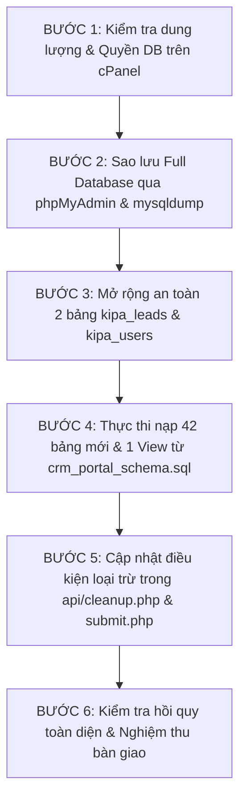

# KIPA VIỆT HÀN — KẾ HOẠCH TRIỂN KHAI, SAO LƯU & PHỤC HỒI DATABASE (DATABASE MIGRATION PLAN)

> **Tài liệu quy trình vận hành chuẩn (SOP):** Kế hoạch triển khai bổ sung 42 bảng vật lý và 1 SQL View CRM & Student Portal trên cPanel Shared Hosting  
> **Phiên bản:** 2.2.0 (Kiểm toán hoàn tất — ĐANG CHỜ PHÊ DUYỆT CỦA USER, CHƯA CHẠY TRÊN PRODUCTION)  
> **Mục tiêu tối thượng:** An toàn 100% dữ liệu cũ, không gián đoạn website, ngăn ngừa xóa dây chuyền và có kịch bản Rollback tức thì.  

---

## I. NGUYÊN TẮC AN TOÀN TRƯỚC KHI THỰC HIỆN

1. **CHƯA THỰC THI TRÊN PRODUCTION:** Hiện tại chỉ kiểm toán, chuẩn bị file và tài liệu. Tuyệt đối không chạy DDL trên cPanel khi chưa được Ban Giám Đốc/User phê duyệt bằng văn bản.
2. **Tuyệt đối không DROP / TRUNCATE:** Không bao giờ chạy lệnh `DROP TABLE`, `DROP COLUMN`, `TRUNCATE TABLE` đối với các bảng hiện hữu.
3. **Không đổi tên bảng/cột:** Mọi bảng và cột hiện có được giữ nguyên 100% tên gọi và kiểu dữ liệu.
4. **Cơ chế thêm mới an toàn:**
   - Tạo bảng mới: Dùng cú pháp `CREATE TABLE IF NOT EXISTS`.
   - Bổ sung cột cho bảng cũ: Cột mới bắt buộc phải là `NULL` hoặc có `DEFAULT`, bảo đảm các câu lệnh `INSERT` cũ không bị lỗi thiếu trường.
5. **Quy tắc sao lưu trước khi chạm vào DB:** Phải có ít nhất 1 bản sao lưu toàn diện (.sql) tải về máy an toàn và kiểm tra đọc được trước khi thực hiện bất kỳ câu lệnh DDL nào.

---

## II. QUY TRÌNH 6 BƯỚC TRIỂN KHAI TRÊN CPANEL (KHI ĐƯỢC DUYỆT)



### BƯỚC 1: XÁC ĐỊNH MỤC TIÊU & KIỂM TRA TÀI NGUYÊN TRÊN CPANEL
1. Đăng nhập vào cPanel Hosting của KIPA Việt Hàn.
2. Kiểm tra dung lượng Disk Space còn trống (yêu cầu tối thiểu còn trống > 500 MB).
3. Kiểm tra mục **MySQL® Databases**:
   - Xác nhận tên Database đang dùng (theo chuỗi kết nối trong `kipa-private/config.php`).
   - Xác nhận User MySQL đang có đầy đủ các quyền: `SELECT`, `INSERT`, `UPDATE`, `DELETE`, `CREATE`, `ALTER`, `INDEX`, `REFERENCES`, `CREATE VIEW`.

---

### BƯỚC 2: SAO LƯU DATABASE ĐẦY ĐỦ (FULL BACKUP PROTOCOL)
Thực hiện sao lưu theo 2 phương thức song song để đảm bảo an toàn tuyệt đối:

#### Phương thức 1: Xuất file qua phpMyAdmin (Giao diện trực quan)
1. Trong cPanel, mở công cụ **phpMyAdmin**.
2. Chọn đúng Database của KIPA ở cột bên trái.
3. Chọn tab **Export (Xuất)** trên thanh menu.
4. Chọn phương thức **Custom (Tùy chỉnh)**:
   - Tables: Chọn **Select All (Chọn tất cả)**.
   - Output: Đặt tên file dạng `kipa_db_backup_truoc_khi_tao_crm_YYYYMMDD_HHMM.sql`. Nén dạng `gzipped` hoặc text thường.
   - Format-specific options: Đánh dấu `Structure and data (Cấu trúc và dữ liệu)`.
   - Object creation options: Đánh dấu `Add DROP TABLE / VIEW statement` (phục vụ rollback khi cần) và `Add CREATE TABLE statement`.
5. Bấm nút **Export (Xuất)** và lưu file an toàn vào thư mục lưu trữ nội bộ.

#### Phương thức 2: Chạy lệnh mysqldump qua cPanel Terminal / SSH (Nếu có quyền)
```bash
mysqldump -u <db_user> -p'<db_password>' <db_name> > ~/kipa-private/backup_pre_crm_$(date +%Y%m%d_%H%M%S).sql
```
- Kiểm tra dung lượng file sao lưu: File phải có kích thước > 0 bytes và phần cuối file có dòng `-- Dump completed on ...`.

---

### BƯỚC 3: MỞ RỘNG AN TOÀN CHO 2 BẢNG HIỆN HỮU (`kipa_leads` và `kipa_users`)

Trong phpMyAdmin -> Tab **SQL**, dán và thực thi đoạn lệnh sau:

```sql
-- 1. Bổ sung liên kết an toàn cho kipa_leads (chống xóa dây chuyền khi cleanup)
ALTER TABLE `kipa_leads` 
  ADD COLUMN IF NOT EXISTS `converted_to_customer_id` BIGINT UNSIGNED NULL AFTER `details_json`,
  ADD COLUMN IF NOT EXISTS `lead_status` VARCHAR(32) NOT NULL DEFAULT 'NEW' AFTER `converted_to_customer_id`;

-- 2. Bổ sung các trường quản lý tài khoản cho kipa_users
ALTER TABLE `kipa_users` 
  ADD COLUMN IF NOT EXISTS `avatar_url` VARCHAR(255) NULL AFTER `phone`,
  ADD COLUMN IF NOT EXISTS `is_active` BOOLEAN NOT NULL DEFAULT 1 AFTER `avatar_url`,
  ADD COLUMN IF NOT EXISTS `last_login_at` DATETIME NULL AFTER `email_verified_at`;
```

---

### BƯỚC 4: THỰC THI TẠO 42 BẢNG BỔ SUNG VÀ 1 VIEW TỪ `crm_portal_schema.sql`

1. Mở file **`crm_portal_schema.sql`** (hoặc `backend/crm_portal_schema.sql`) trong mã nguồn dự án.
2. Sao chép toàn bộ nội dung file.
3. Trong phpMyAdmin -> Chọn Database KIPA -> Chọn tab **SQL**.
4. Dán toàn bộ nội dung file `crm_portal_schema.sql` vào khung nhập liệu.
5. Bấm nút **Go (Thực hiện)**.
6. Kết quả mong đợi: MySQL báo thực thi thành công, tạo mới 42 bảng vật lý và 1 View `kipa_student_documents`.

---

### BƯỚC 5: CẬP NHẬT MÃ NGUỒN PHÒNG CHỐNG XÓA LEAD TRONG `api/cleanup.php` & `api/submit.php`

**LƯU Ý:** Trên mã nguồn hiện tại, các file này **CHƯA ĐƯỢC SỬA**. Đây là các bước cần triển khai trên máy chủ khi đưa CRM vào hoạt động:

1. **Cập nhật `api/cleanup.php` (dòng 16):**
   ```php
   // Đoạn mã cũ:
   // $leads = $db->exec('DELETE FROM kipa_leads WHERE created_at < UTC_TIMESTAMP() - INTERVAL 12 MONTH');
   
   // Đoạn mã mới đã bảo vệ:
   $leads = $db->exec('DELETE FROM kipa_leads WHERE (converted_to_customer_id IS NULL OR converted_to_customer_id = 0) AND created_at < UTC_TIMESTAMP() - INTERVAL 12 MONTH');
   ```

2. **Cập nhật `api/submit.php` (dòng 200):**
   ```php
   // Đoạn mã cũ:
   // $db->exec('DELETE FROM kipa_leads WHERE created_at < UTC_TIMESTAMP() - INTERVAL 12 MONTH');
   
   // Đoạn mã mới đã bảo vệ:
   $db->exec('DELETE FROM kipa_leads WHERE (converted_to_customer_id IS NULL OR converted_to_customer_id = 0) AND created_at < UTC_TIMESTAMP() - INTERVAL 12 MONTH');
   ```

---

### BƯỚC 6: KIỂM TRA HỒI QUY TOÀN DIỆN (REGRESSION TESTING)

Thực hiện kiểm thử xác nhận:
1. **Kiểm tra Website công khai:**
   - Truy cập trang chủ `https://kipaviethan.edu.vn`.
   - Nộp thử 1 form tư vấn nhanh tại trang chủ hoặc trang du học Hàn Quốc.
   - Xác nhận bản ghi xuất hiện trong `kipa_leads`.
2. **Kiểm tra Xác thực:**
   - Đăng nhập tài khoản học viên hiện tại tại `/ho-so.html`.
   - Xác nhận hệ thống đọc đúng từ `kipa_users` và không bị lỗi trường thiếu.
3. **Kiểm tra View Kho Tài Liệu:**
   - Chạy thử câu truy vấn: `SELECT * FROM kipa_student_documents LIMIT 5;`.
   - Xác nhận View hoạt động trơn tru không báo lỗi cú pháp.

---

## III. KỊCH BẢN PHỤC HỒI NHANH (ROLLBACK PLAN)

Trong trường hợp xảy ra bất kỳ lỗi không mong muốn nào:

### Tình huống 1: Lỗi trong quá trình tạo bảng mới
Vì toàn bộ 42 bảng mới đều độc lập và có tiền tố `kipa_`, việc hủy bỏ cực kỳ an toàn:
```sql
SET FOREIGN_KEY_CHECKS = 0;
DROP VIEW IF EXISTS `kipa_student_documents`;
DROP TABLE IF EXISTS 
  `kipa_notification_settings`, `kipa_student_support`, `kipa_student_materials`,
  `kipa_student_notifications`, `kipa_student_schedules`, `kipa_student_journey`,
  `kipa_students`, `kipa_document_access_logs`, `kipa_document_reviews`, `kipa_document_versions`,
  `kipa_dossier_documents`, `kipa_audit_logs`, `kipa_approvals`, `kipa_approval_workflow_steps`,
  `kipa_approval_workflows`, `kipa_task_history`, `kipa_task_collaborators`, `kipa_tasks`,
  `kipa_working_calendars`, `kipa_sla_policies`, `kipa_dossier_status_history`,
  `kipa_dossier_assignments`, `kipa_service_dossiers`, `kipa_consultation_activities`,
  `kipa_consultation_interests`, `kipa_consultation_dossiers`, `kipa_campaigns`,
  `kipa_lead_sources`, `kipa_customer_education`, `kipa_customer_relations`,
  `kipa_customer_addresses`, `kipa_customers`, `kipa_role_delegations`,
  `kipa_staff_role_history`, `kipa_staff_roles`, `kipa_role_permissions`,
  `kipa_permissions`, `kipa_roles`, `kipa_staff`, `kipa_teams`, `kipa_departments`, `kipa_branches`;
SET FOREIGN_KEY_CHECKS = 1;
```
*Lưu ý: Không bao giờ DROP 5 bảng nền tảng `kipa_leads`, `kipa_rate_limits`, `kipa_otp_codes`, `kipa_users`, `kipa_admins`.*

### Tình huống 2: Phục hồi toàn diện từ file sao lưu (Disaster Recovery)
1. Trong phpMyAdmin, chọn tab **Import (Nhập)**.
2. Chọn file `kipa_db_backup_truoc_khi_tao_crm_YYYYMMDD_HHMM.sql`.
3. Bấm **Go (Thực hiện)** để hoàn nguyên database về trạng thái ban đầu trước khi triển khai.
