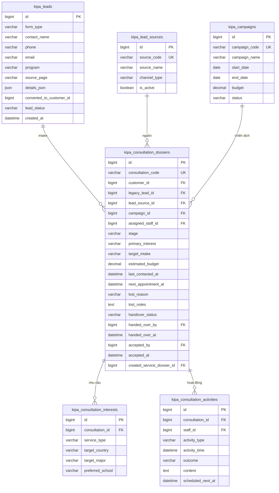
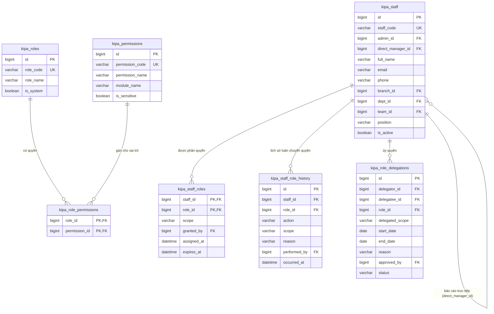
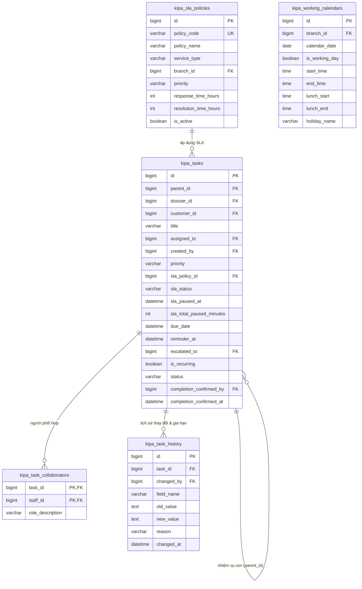
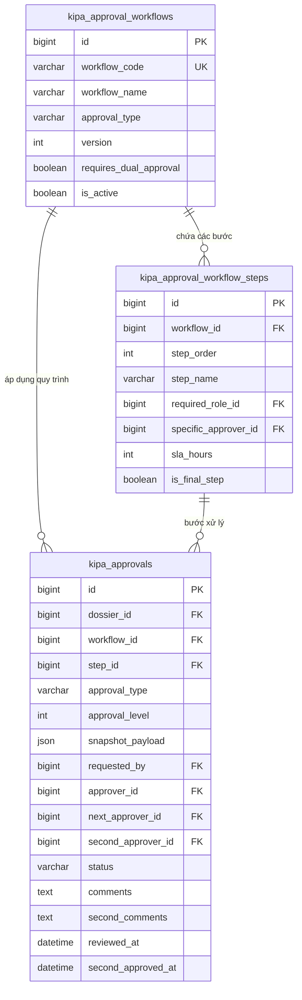
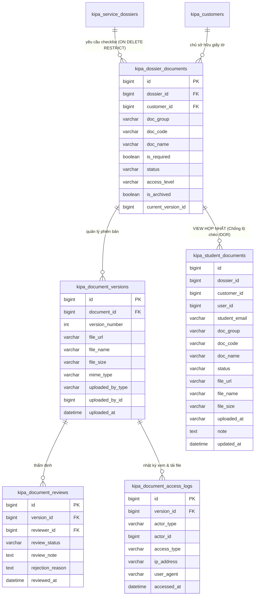

# KIPA VIỆT HÀN — SƠ ĐỒ QUAN HỆ THỰC THỂ DỮ LIỆU (DATABASE RELATIONSHIP MAP)

> **Tài liệu kiến trúc cơ sở dữ liệu:** Sơ đồ quan hệ thực thể (ERD) kết nối Website, CRM, Student Portal và LMS  
> **Phiên bản:** 2.2.0 (Hoàn thiện nghiệp vụ Tiếp nhận & Tư vấn, Phân quyền, SLA, Phê duyệt kép, Bảo vệ Kho tài liệu & Bảo mật Cổng học viên)  
> **Chuẩn mô hình hóa:** Mermaid ER Diagrams & Khóa ngoại MySQL InnoDB  

---

## I. SƠ ĐỒ QUAN HỆ TỔNG THỂ HỆ THỐNG (MASTER ARCHITECTURE ERD)

```mermaid
erDiagram
    %% WEBSITE CORE & AUTHENTICATION
    kipa_leads ||--o| kipa_customers : "chuyển đổi thành (ON DELETE SET NULL)"
    kipa_leads ||--o{ kipa_consultation_dossiers : "intake vào tư vấn (ON DELETE SET NULL)"
    kipa_users ||--o| kipa_customers : "tài khoản đăng nhập 1-1 (ON DELETE SET NULL)"
    kipa_admins ||--o| kipa_staff : "tài khoản quản trị nhân sự (ON DELETE SET NULL)"
    kipa_users ||--o| kipa_students : "xác thực cổng học viên"

    %% CRM ORGANIZATION & ADVANCED RBAC
    kipa_branches ||--o{ kipa_departments : "có các phòng ban"
    kipa_branches ||--o{ kipa_staff : "trực thuộc chi nhánh"
    kipa_branches ||--o{ kipa_customers : "tiếp nhận khách hàng"
    kipa_branches ||--o{ kipa_working_calendars : "lịch làm việc theo chi nhánh"
    kipa_branches ||--o{ kipa_sla_policies : "áp dụng SLA chi nhánh"
    kipa_departments ||--o{ kipa_teams : "chia thành nhóm chuyên môn"
    kipa_departments ||--o{ kipa_staff : "thuộc phòng ban"
    kipa_teams ||--o{ kipa_staff : "thuộc nhóm chuyên môn"
    kipa_staff ||--o{ kipa_staff : "quản lý trực tiếp chính"
    kipa_roles ||--o{ kipa_role_permissions : "gồm các quyền"
    kipa_permissions ||--o{ kipa_role_permissions : "thuộc các vai trò"
    kipa_staff ||--o{ kipa_staff_roles : "được gán vai trò"
    kipa_roles ||--o{ kipa_staff_roles : "vai trò hệ thống"
    kipa_staff ||--o{ kipa_staff_role_history : "lịch sử luân chuyển quyền"
    kipa_staff ||--o{ kipa_role_delegations : "người ủy quyền"
    kipa_staff ||--o{ kipa_role_delegations : "người được ủy quyền"
    kipa_roles ||--o{ kipa_role_delegations : "vai trò ủy quyền"

    %% CRM CUSTOMER MASTER
    kipa_customers ||--o{ kipa_customer_addresses : "sổ địa chỉ"
    kipa_customers ||--o{ kipa_customer_relations : "quan hệ nhân thân & bảo lãnh"
    kipa_customers ||--o{ kipa_customer_education : "học vấn, GPA & chứng chỉ"
    kipa_customers ||--o{ kipa_consultation_dossiers : "có các đợt tư vấn"
    kipa_customers ||--o{ kipa_service_dossiers : "ký các hợp đồng dịch vụ"
    kipa_customers ||--o| kipa_students : "cache profile cổng học viên"
    kipa_customers ||--o| kipa_notification_settings : "cấu hình nhận tin"

    %% LEAD INTAKE & CONSULTATION DOSSIERS
    kipa_lead_sources ||--o{ kipa_consultation_dossiers : "nguồn tiếp nhận"
    kipa_campaigns ||--o{ kipa_consultation_dossiers : "chiến dịch marketing"
    kipa_staff ||--o{ kipa_consultation_dossiers : "chuyên viên tư vấn phụ trách"
    kipa_consultation_dossiers ||--o{ kipa_consultation_interests : "chi tiết nhu cầu dịch vụ"
    kipa_consultation_dossiers ||--o{ kipa_consultation_activities : "lịch sử cuộc gọi, gặp mặt, lịch hẹn"
    kipa_consultation_dossiers ||--o| kipa_service_dossiers : "bàn giao khi ký hợp đồng"

    %% SERVICE DOSSIERS & LIFECYCLE
    kipa_staff ||--o{ kipa_service_dossiers : "tư vấn phụ trách"
    kipa_staff ||--o{ kipa_service_dossiers : "chuyên viên hồ sơ xử lý"
    kipa_staff ||--o{ kipa_service_dossiers : "cộng tác viên giới thiệu (CTV)"
    kipa_service_dossiers ||--o{ kipa_dossier_assignments : "lịch sử phân công & bàn giao"
    kipa_service_dossiers ||--o{ kipa_dossier_status_history : "lịch sử tạm dừng, mở lại, đóng, lưu trữ"
    kipa_service_dossiers ||--o{ kipa_tasks : "nhiệm vụ gắn với hồ sơ"
    kipa_service_dossiers ||--o{ kipa_approvals : "yêu cầu phê duyệt"
    kipa_service_dossiers ||--o{ kipa_dossier_documents : "checklist hồ sơ giấy tờ (RESTRICT)"
    kipa_service_dossiers ||--o{ kipa_student_journey : "5 mốc tiến độ hành trình"

    %% TASKS & SLA POLICIES
    kipa_sla_policies ||--o{ kipa_tasks : "chính sách cam kết SLA"
    kipa_tasks ||--o{ kipa_tasks : "nhiệm vụ con (parent_id)"
    kipa_tasks ||--o{ kipa_task_collaborators : "người phối hợp"
    kipa_staff ||--o{ kipa_task_collaborators : "tham gia phối hợp"
    kipa_tasks ||--o{ kipa_task_history : "lịch sử thay đổi & gia hạn"

    %% APPROVAL WORKFLOWS & SNAPSHOTS
    kipa_approval_workflows ||--o{ kipa_approval_workflow_steps : "các bước quy trình"
    kipa_approval_workflows ||--o{ kipa_approvals : "quy trình áp dụng"
    kipa_approval_workflow_steps ||--o{ kipa_approvals : "bước hiện tại"
    kipa_staff ||--o{ kipa_approvals : "người gửi duyệt"
    kipa_staff ||--o{ kipa_approvals : "người duyệt 1"
    kipa_staff ||--o{ kipa_approvals : "người duyệt 2 (phê duyệt kép)"

    %% MASTER DOCUMENT VAULT & ACCESS LOGS
    kipa_dossier_documents ||--o{ kipa_document_versions : "quản lý các phiên bản"
    kipa_document_versions ||--o{ kipa_document_reviews : "lịch sử thẩm định & phản hồi"
    kipa_document_versions ||--o{ kipa_document_access_logs : "nhật ký xem & tải file nhạy cảm"
    kipa_dossier_documents ||--o{ kipa_student_documents : "VIEW ánh xạ sang cổng học viên"

    %% STUDENT PORTAL EXPERIENCES
    kipa_customers ||--o{ kipa_student_schedules : "lịch học & lịch hẹn"
    kipa_customers ||--o{ kipa_student_notifications : "thông báo đẩy"
    kipa_customers ||--o{ kipa_student_support : "ticket yêu cầu hỗ trợ"
    kipa_staff ||--o{ kipa_student_support : "chuyên viên tiếp nhận giải đáp"
```

---

## II. SƠ ĐỒ CHI TIẾT TIẾP NHẬN LEAD & HỒ SƠ TƯ VẤN (CONSULTATION INTAKE)

---

## III. SƠ ĐỒ CHI TIẾT CƠ CẤU TỔ CHỨC & PHÂN QUYỀN RBAC NÂNG CAO

---

## IV. SƠ ĐỒ CHI TIẾT NHIỆM VỤ, QUẢN LÝ SLA & LỊCH LÀM VIỆC

---

## V. SƠ ĐỒ CHI TIẾT QUY TRÌNH PHÊ DUYỆT & PHÊ DUYỆT KÉP

---

## VI. SƠ ĐỒ KHO TÀI LIỆU GỐC, NHẬT KÝ TRUY CẬP & VIEW CỔNG HỌC VIÊN

