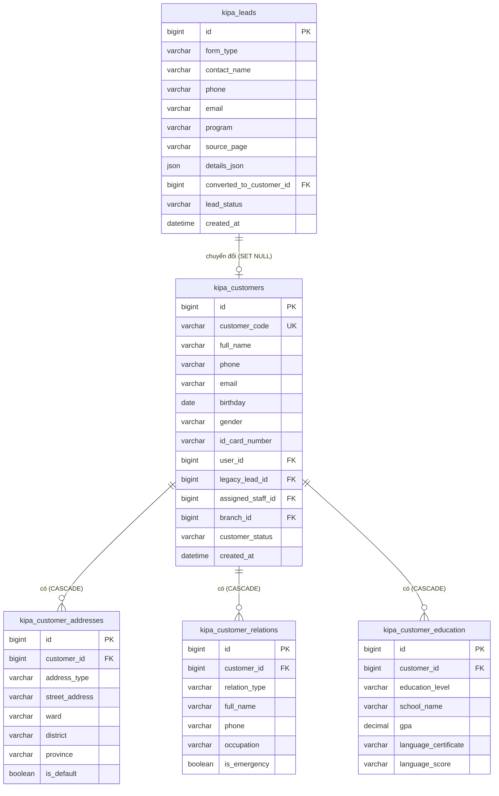
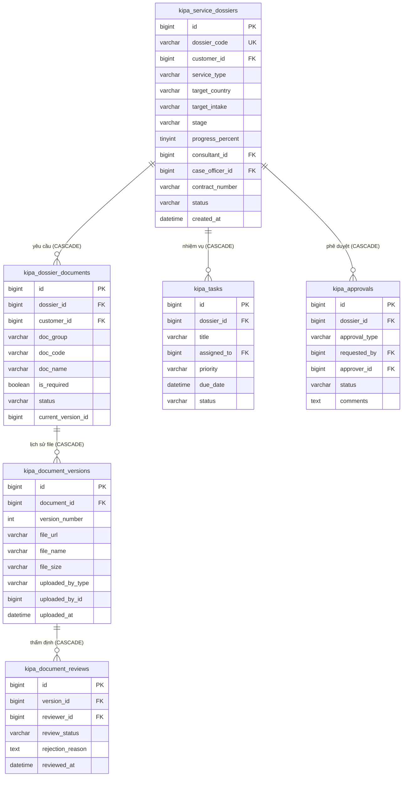

# KIPA VIỆT HÀN — SƠ ĐỒ QUAN HỆ THỰC THỂ DỮ LIỆU (DATABASE RELATIONSHIP MAP)

> **Tài liệu kiến trúc cơ sở dữ liệu:** Sơ đồ quan hệ thực thể (ERD) kết nối Website, CRM, Student Portal và LMS  
> **Chuẩn mô hình hóa:** Mermaid ER Diagrams & Quan hệ khóa ngoại MySQL InnoDB  

---

## I. SƠ ĐỒ QUAN HỆ TỔNG THỂ (MASTER ARCHITECTURE ERD)

```mermaid
erDiagram
    %% WEBSITE & AUTHENTICATION
    kipa_leads ||--o| kipa_customers : "chuyển đổi thành (ON DELETE SET NULL)"
    kipa_users ||--o| kipa_customers : "tài khoản đăng nhập 1-1 (ON DELETE SET NULL)"
    kipa_admins ||--o| kipa_staff : "tài khoản admin nhân sự (ON DELETE SET NULL)"
    kipa_users ||--o| kipa_students : "xác thực cổng học viên"

    %% CRM ORGANIZATION & STAFF
    kipa_branches ||--o{ kipa_departments : "có nhiều"
    kipa_branches ||--o{ kipa_staff : "trực thuộc chi nhánh"
    kipa_departments ||--o{ kipa_staff : "thuộc phòng ban"
    kipa_staff ||--o{ kipa_staff_roles : "được gán"
    kipa_roles ||--o{ kipa_staff_roles : "chứa"
    kipa_roles ||--o{ kipa_permissions : "có quyền"

    %% CRM CUSTOMER MASTER
    kipa_customers ||--o{ kipa_customer_addresses : "có các địa chỉ"
    kipa_customers ||--o{ kipa_customer_relations : "có người thân / khẩn cấp"
    kipa_customers ||--o{ kipa_customer_education : "có hồ sơ học vấn & ngoại ngữ"
    kipa_customers ||--o{ kipa_service_dossiers : "đăng ký các hồ sơ dịch vụ"

    %% CRM SERVICE DOSSIER & TASKS
    kipa_staff ||--o{ kipa_service_dossiers : "tư vấn phụ trách"
    kipa_staff ||--o{ kipa_service_dossiers : "chuyên viên hồ sơ"
    kipa_service_dossiers ||--o{ kipa_dossier_assignments : "lịch sử bàn giao"
    kipa_service_dossiers ||--o{ kipa_tasks : "có các nhiệm vụ"
    kipa_service_dossiers ||--o{ kipa_dossier_documents : "yêu cầu các giấy tờ"
    kipa_service_dossiers ||--o{ kipa_approvals : "quy trình phê duyệt"

    %% DOCUMENTS & VERSIONING
    kipa_dossier_documents ||--o{ kipa_document_versions : "quản lý các phiên bản"
    kipa_document_versions ||--o{ kipa_document_reviews : "lịch sử thẩm định"

    %% STUDENT PORTAL VIEWS
    kipa_customers ||--o| kipa_students : "đồng bộ góc nhìn học viên"
    kipa_service_dossiers ||--o{ kipa_student_journey : "phản ánh 5 bước lộ trình"
    kipa_dossier_documents ||--o{ kipa_student_documents : "hiển thị ví hồ sơ số"
    kipa_customers ||--o{ kipa_student_schedules : "lịch học & lịch hẹn"
    kipa_customers ||--o{ kipa_student_notifications : "nhận thông báo"
    kipa_customers ||--o{ kipa_student_support : "gửi ticket hỗ trợ"

    %% LMS FOUNDATION
    kipa_staff ||--o{ kipa_lms_classes : "giáo viên giảng dạy"
    kipa_lms_classes ||--o{ kipa_lms_lessons : "các buổi học"
    kipa_lms_classes ||--o{ kipa_lms_enrollments : "danh sách học viên"
    kipa_customers ||--o{ kipa_lms_enrollments : "tham gia lớp học"
    kipa_lms_lessons ||--o{ kipa_lms_attendance : "điểm danh"
    kipa_lms_enrollments ||--o{ kipa_lms_attendance : "chuyên cần"
```

---

## II. SƠ ĐỒ CHI TIẾT PHÂN HỆ KHÁCH HÀNG & TƯ VẤN (CUSTOMER & CONSULTATION)

---

## III. SƠ ĐỒ CHI TIẾT HỒ SƠ DỊCH VỤ, TÀI LIỆU & PHÊ DUYỆT (DOSSIERS & APPROVALS)

---

## IV. BẢNG MÔ TẢ RÀNG BUỘC KHÓA NGOẠI (FOREIGN KEY CONSTRAINTS)

| Bảng nguồn | Cột khóa ngoại | Bảng đích | Cột đích | Quy tắc ON DELETE | Quy tắc ON UPDATE | Ý nghĩa kiến trúc |
|---|---|---|---|---|---|---|
| `kipa_customers` | `user_id` | `kipa_users` | `id` | `SET NULL` | `CASCADE` | Xóa tài khoản login không làm mất dữ liệu khách hàng |
| `kipa_customers` | `legacy_lead_id` | `kipa_leads` | `id` | **`SET NULL`** | `CASCADE` | **CỰC KỲ QUAN TRỌNG:** Xóa lead cũ 12 tháng không xóa khách hàng |
| `kipa_customers` | `branch_id` | `kipa_branches` | `id` | `SET NULL` | `CASCADE` | Trực thuộc chi nhánh |
| `kipa_customer_addresses` | `customer_id` | `kipa_customers` | `id` | `CASCADE` | `CASCADE` | Xóa khách hàng xóa toàn bộ sổ địa chỉ |
| `kipa_customer_relations` | `customer_id` | `kipa_customers` | `id` | `CASCADE` | `CASCADE` | Xóa khách hàng xóa toàn bộ quan hệ nhân thân |
| `kipa_customer_education` | `customer_id` | `kipa_customers` | `id` | `CASCADE` | `CASCADE` | Xóa khách hàng xóa toàn bộ học bạ |
| `kipa_service_dossiers` | `customer_id` | `kipa_customers` | `id` | **`RESTRICT`** | `CASCADE` | Không cho phép xóa khách hàng khi đang có hồ sơ hợp đồng |
| `kipa_service_dossiers` | `consultant_id` | `kipa_staff` | `id` | `SET NULL` | `CASCADE` | Nhân viên nghỉ việc không làm hỏng hồ sơ khách |
| `kipa_service_dossiers` | `case_officer_id` | `kipa_staff` | `id` | `SET NULL` | `CASCADE` | Chuyên viên hồ sơ bàn giao |
| `kipa_dossier_documents` | `dossier_id` | `kipa_service_dossiers` | `id` | `CASCADE` | `CASCADE` | Giấy tờ thuộc về hồ sơ |
| `kipa_document_versions` | `document_id` | `kipa_dossier_documents` | `id` | `CASCADE` | `CASCADE` | Phiên bản thuộc về đầu giấy tờ |
| `kipa_document_reviews` | `version_id` | `kipa_document_versions` | `id` | `CASCADE` | `CASCADE` | Thẩm định theo từng phiên bản file |
| `kipa_tasks` | `dossier_id` | `kipa_service_dossiers` | `id` | `CASCADE` | `CASCADE` | Nhiệm vụ của hồ sơ |
| `kipa_tasks` | `assigned_to` | `kipa_staff` | `id` | `RESTRICT` | `CASCADE` | Nhân viên phải tồn tại |
| `kipa_approvals` | `dossier_id` | `kipa_service_dossiers` | `id` | `CASCADE` | `CASCADE` | Phê duyệt hồ sơ |
| `kipa_staff` | `admin_id` | `kipa_admins` | `id` | `SET NULL` | `CASCADE` | Liên kết tài khoản kỹ thuật |
| `kipa_staff` | `branch_id` | `kipa_branches` | `id` | `SET NULL` | `CASCADE` | Chi nhánh công tác |
| `kipa_staff` | `dept_id` | `kipa_departments` | `id` | `SET NULL` | `CASCADE` | Phòng ban công tác |
