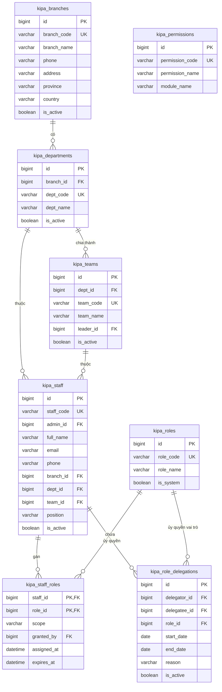
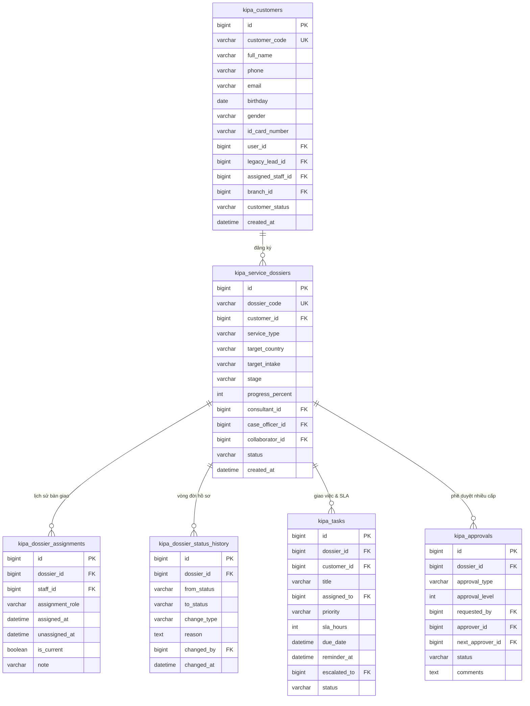
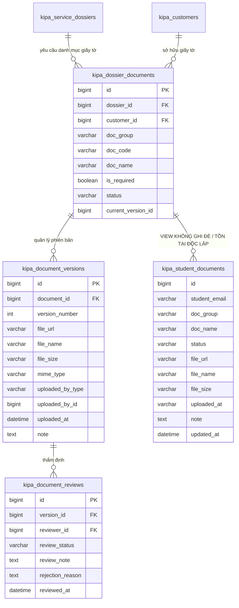

# KIPA VIỆT HÀN — SƠ ĐỒ QUAN HỆ THỰC THỂ DỮ LIỆU (DATABASE RELATIONSHIP MAP)

> **Tài liệu kiến trúc cơ sở dữ liệu:** Sơ đồ quan hệ thực thể (ERD) kết nối Website, CRM, Student Portal và LMS  
> **Phiên bản:** 2.1.0 (Vòng kiểm tra & Đối chiếu kỹ thuật cuối cùng)  
> **Chuẩn mô hình hóa:** Mermaid ER Diagrams & Khóa ngoại MySQL InnoDB  

---

## I. SƠ ĐỒ QUAN HỆ TỔNG THỂ HỆ THỐNG (MASTER ARCHITECTURE ERD)

```mermaid
erDiagram
    %% WEBSITE CORE & AUTHENTICATION
    kipa_leads ||--o| kipa_customers : "chuyển đổi thành (ON DELETE SET NULL)"
    kipa_users ||--o| kipa_customers : "tài khoản đăng nhập 1-1 (ON DELETE SET NULL)"
    kipa_admins ||--o| kipa_staff : "tài khoản quản trị nhân sự (ON DELETE SET NULL)"
    kipa_users ||--o| kipa_students : "xác thực cổng học viên"

    %% CRM ORGANIZATION & ADVANCED RBAC
    kipa_branches ||--o{ kipa_departments : "có các phòng ban"
    kipa_branches ||--o{ kipa_staff : "trực thuộc chi nhánh"
    kipa_branches ||--o{ kipa_customers : "tiếp nhận khách hàng"
    kipa_departments ||--o{ kipa_teams : "chia thành các nhóm chuyên môn"
    kipa_departments ||--o{ kipa_staff : "thuộc phòng ban"
    kipa_teams ||--o{ kipa_staff : "thuộc nhóm chuyên môn"
    kipa_staff ||--o{ kipa_staff_roles : "được gán vai trò"
    kipa_roles ||--o{ kipa_staff_roles : "vai trò hệ thống"
    kipa_roles ||--o{ kipa_permissions : "gồm các quyền hạn"
    kipa_staff ||--o{ kipa_role_delegations : "người ủy quyền"
    kipa_staff ||--o{ kipa_role_delegations : "người được ủy quyền"
    kipa_roles ||--o{ kipa_role_delegations : "vai trò ủy quyền"

    %% CRM CUSTOMER MASTER
    kipa_customers ||--o{ kipa_customer_addresses : "sổ địa chỉ"
    kipa_customers ||--o{ kipa_customer_relations : "quan hệ nhân thân & bảo lãnh"
    kipa_customers ||--o{ kipa_customer_education : "học vấn, GPA & chứng chỉ"
    kipa_customers ||--o{ kipa_service_dossiers : "đăng ký các hồ sơ dịch vụ"
    kipa_customers ||--o| kipa_students : "cache profile cổng học viên"
    kipa_customers ||--o| kipa_notification_settings : "cấu hình nhận tin"

    %% CRM SERVICE DOSSIERS & WORKFLOW
    kipa_staff ||--o{ kipa_service_dossiers : "cố vấn tư vấn phụ trách"
    kipa_staff ||--o{ kipa_service_dossiers : "chuyên viên hồ sơ xử lý"
    kipa_staff ||--o{ kipa_service_dossiers : "cộng tác viên giới thiệu (CTV)"
    kipa_service_dossiers ||--o{ kipa_dossier_assignments : "lịch sử phân công & bàn giao"
    kipa_service_dossiers ||--o{ kipa_dossier_status_history : "lịch sử tạm dừng, mở lại, đóng, lưu trữ"
    kipa_service_dossiers ||--o{ kipa_tasks : "nhiệm vụ & cam kết SLA"
    kipa_service_dossiers ||--o{ kipa_approvals : "quy trình phê duyệt nhiều cấp"
    kipa_service_dossiers ||--o{ kipa_dossier_documents : "checklist hồ sơ giấy tờ"
    kipa_service_dossiers ||--o{ kipa_student_journey : "5 mốc tiến độ hành trình"

    %% MASTER DOCUMENT VAULT
    kipa_dossier_documents ||--o{ kipa_document_versions : "các phiên bản file scan/PDF"
    kipa_document_versions ||--o{ kipa_document_reviews : "lịch sử thẩm định & phản hồi"
    kipa_dossier_documents ||--o{ kipa_student_documents : "VIEW ánh xạ sang cổng học viên"

    %% STUDENT PORTAL EXPERIENCES
    kipa_customers ||--o{ kipa_student_schedules : "lịch học & lịch hẹn"
    kipa_customers ||--o{ kipa_student_notifications : "thông báo đẩy"
    kipa_customers ||--o{ kipa_student_support : "ticket yêu cầu hỗ trợ"
    kipa_staff ||--o{ kipa_student_support : "chuyên viên tiếp nhận giải đáp"

    %% LMS FOUNDATION (STAGE 2)
    kipa_staff ||--o{ kipa_lms_classes : "giáo viên phụ trách"
    kipa_lms_classes ||--o{ kipa_lms_lessons : "chi tiết buổi học"
    kipa_lms_classes ||--o{ kipa_lms_enrollments : "danh sách học viên ghi danh"
    kipa_customers ||--o{ kipa_lms_enrollments : "khách hàng tham gia khóa học"
    kipa_lms_lessons ||--o{ kipa_lms_attendance : "điểm danh từng buổi"
    kipa_lms_enrollments ||--o{ kipa_lms_attendance : "chuyên cần của học viên"
    kipa_lms_classes ||--o{ kipa_lms_exams : "kỳ thi đánh giá"
    kipa_lms_exams ||--o{ kipa_lms_grades : "bảng điểm thi"
    kipa_lms_enrollments ||--o{ kipa_lms_grades : "điểm của từng học viên"
```

---

## II. SƠ ĐỒ CHI TIẾT CƠ CẤU TỔ CHỨC & PHÂN QUYỀN RBAC NÂNG CAO

---

## III. SƠ ĐỒ CHI TIẾT KHÁCH HÀNG, HỒ SƠ DỊCH VỤ & QUY TRÌNH XỬ LÝ

---

## IV. SƠ ĐỒ CHI TIẾT KHO TÀI LIỆU DUY NHẤT & VIEW CỔNG HỌC VIÊN

---

## V. NGUYÊN TẮC RÀNG BUỘC TOÀN VẸN (INTEGRITY CONSTRAINTS)

1. **Bảo tồn khách hàng khi xóa Lead rác (`legacy_lead_id`):**  
   `ON DELETE SET NULL` — Tuyệt đối không dùng `CASCADE` để bảo vệ khách hàng khỏi cronjob dọn dẹp sau 12 tháng của `api/cleanup.php`.
2. **Xóa theo tầng đối với thông tin bổ trợ khách hàng:**  
   Khi khách hàng bị xóa có chủ đích (GDPR/quyết định Ban Giám Đốc), các bảng `kipa_customer_addresses`, `kipa_customer_relations`, `kipa_customer_education` sẽ tự động xóa dọn dẹp theo (`ON DELETE CASCADE`).
3. **Bảo vệ hồ sơ dịch vụ (`customer_id` trong `kipa_service_dossiers`):**  
   `ON DELETE RESTRICT` — Không cho phép xóa khách hàng nếu khách hàng đó đang có hồ sơ dịch vụ hoặc hợp đồng đang xử lý.
4. **Nhân sự rời khỏi công ty (`assigned_to`, `case_officer_id`):**  
   `ON DELETE SET NULL` hoặc `ON DELETE RESTRICT` — Ngăn ngừa xóa mất dấu nhân viên đã ký duyệt hoặc phụ trách hồ sơ.
