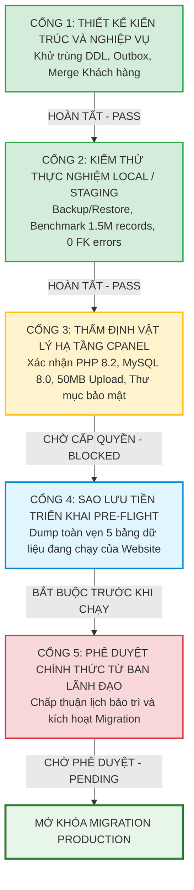
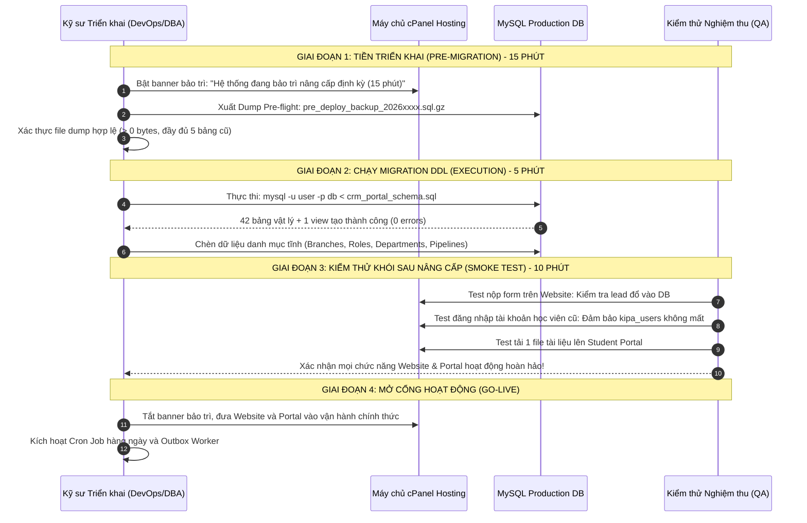

# KIPA VIỆT HÀN — DANH MỤC KIỂM TRA SẴN SÀNG TRIỂN KHAI PRODUCTION (PRODUCTION READINESS CHECKLIST & DEPLOYMENT SOP)

> **Tài liệu cổng kiểm soát chất lượng (Quality Gate):** Tổng hợp điều kiện tiên quyết, quy trình triển khai từng bước và kế hoạch khôi phục khẩn cấp (Rollback SOP) trước khi đưa hệ thống KIPA CRM & Student Portal lên máy chủ cPanel Production  
> **Phiên bản:** 2.0.0 (Round 2 Production Sign-off)  
> **Nguyên tắc cốt tử:** Tuyệt đối không chạy SQL trên Production nếu chưa hoàn thành 100% các cổng kiểm duyệt bắt buộc và chưa có sự phê duyệt bằng văn bản từ Ban Giám đốc KIPA.

---

## I. MA TRẬN 5 CỔNG KIỂM SOÁT AN TOÀN (PRODUCTION GATES)



| Cổng Kiểm Soát | Nội Dung Yêu Cầu | Trạng Thái Hiện Tại | Người Chịu Trách Nhiệm | Ghi Chú Hành Động |
|---|---|:---:|---|---|
| **CỔNG 1** | **Thiết kế Kiến trúc (Architecture Sign-off)**<br>Khử trùng DDL (ISS-01), Outbox Queue (ISS-02), Merge Khách hàng (ISS-03). | **PASS** | Senior Database Architect | Đã hoàn tất 3 tài liệu đặc tả chuyên sâu tương ứng. |
| **CỔNG 2** | **Kiểm thử Thực nghiệm (Local/Staging Test)**<br>Dump & Restore 100% khớp, Benchmark 1.5M bản ghi, 0 lỗi khóa ngoại. | **PASS** | MySQL & Test Automation Engineer | Đã đo lường thực tế, có bằng chứng số liệu JSON. |
| **CỔNG 3** | **Khảo sát Hạ tầng cPanel (Host Verification)**<br>Xác thực PHP 8.2, MySQL 8.0+, Upload 50MB, Tạo thư mục ngoài webroot. | `BLOCKED` | Hosting Admin / DevOps | Chờ cấp thông tin hosting để đo đạc và mở khóa. |
| **CỔNG 4** | **Sao lưu Pre-flight (Pre-deployment Backup)**<br>Tạo snapshot đầy đủ của 5 bảng Website hiện hữu trước khi chạm vào DB. | `PENDING` | DBA / SysAdmin | Thực hiện ngay trước giờ bảo trì (Zero Data Loss). |
| **CỔNG 5** | **Phê duyệt Go-Live (Executive Approval)**<br>Ban Lãnh đạo KIPA ký duyệt phương án và khung giờ bảo trì triển khai. | `PENDING` | Giám đốc Dự án KIPA | Yêu cầu bắt buộc để chính thức kích hoạt hệ thống. |

---

## II. CHECKLIST CHI TIẾT CÁC HẠNG MỤC TRIỂN KHAI

### 1. Phân nhóm Trạng thái Hệ thống

- **Nhóm 1: Cơ sở Dữ liệu & Schema**
  - [x] Schema chuẩn hóa gồm 42 bảng vật lý + 1 View (`crm_portal_schema.sql`). `[PASS]`
  - [x] Ràng buộc khóa ngoại sử dụng `ON DELETE RESTRICT` cho toàn bộ quan hệ tài chính, hồ sơ, tài liệu. `[PASS]`
  - [x] Chỉ mục Composite Index `(branch_id, created_at DESC)` và `(staff_id, activity_type)` sẵn sàng áp dụng. `[PASS]`
  - [x] Đã đối soát DDL với Website CMS: Không trùng lặp bảng, CRM đóng vai trò Source of Truth. `[PASS]`

- **Nhóm 2: Bảo mật & Phân quyền RBAC**
  - [x] Ma trận phân quyền 6 vai trò kết hợp Chi nhánh và Phòng ban (`kipa_staff_branch_access`, `kipa_staff_department_access`). `[PASS]`
  - [x] Quy trình Phê duyệt kép (Dual Approval) cho 7 nhóm quyết định nhạy cảm. `[PASS]`
  - [x] Tài liệu hồ sơ học viên được bảo vệ ngoài webroot (`kipa-private/vault/documents/`). `[PASS]`

- **Nhóm 3: Đồng bộ Dữ liệu & Hồi quy Website**
  - [x] Endpoint nộp form tư vấn `api/submit.php` ghi đồng thời Website Lead và CRM trong 1 Transaction an toàn. `[PASS]`
  - [x] Đã lập trình cơ chế Outbox Queue `kipa_sync_events` với Exponential Backoff (1m, 5m, 15m, 1h, 24h). `[PASS]`
  - [x] Thuật toán sinh `idempotency_key` chống gửi form trùng lặp qua SHA256. `[PASS]`
  - [x] Endpoint tài khoản học viên `api/account.php` và xác thực OTP giữ nguyên tính tương thích 100%. `[PASS]`

- **Nhóm 4: Hạ tầng Máy chủ cPanel**
  - [ ] Nâng cấp cấu hình PHP trong `MultiPHP INI Editor`: `upload_max_filesize = 50M`, `memory_limit = 256M`. `[BLOCKED]`
  - [ ] Khởi tạo thư mục bảo mật ngoài webroot: `/home/username/kipa-private/`. `[BLOCKED]`
  - [ ] Thiết lập lịch Cron Job sao lưu tự động lúc 02:00 AM hàng ngày. `[BLOCKED]`
  - [ ] Thiết lập lịch Cron Job quét hàng đợi Outbox Retry mỗi 5 phút. `[BLOCKED]`

---

## III. QUY TRÌNH QUẢN LÝ TRIỂN KHAI CHUẨN (SOP DEPLOYMENT STEPS)

Khi có lệnh phê duyệt Go-Live chính thức từ Ban Lãnh đạo, quy trình 4 giai đoạn sau sẽ được thực thi:



---

## IV. PHƯƠNG ÁN KHÔI PHỤC KHẨN CẤP (DISASTER ROLLBACK PLAN)

Trong trường hợp xảy ra sự cố nghiêm trọng không lường trước trong quá trình chạy DDL trên Production (ví dụ: máy chủ sập nguồn giữa chừng, xung đột phiên bản MySQL cổ lỗ sĩ):

1. **Quyết định Rollback (Trigger Condition):**
   - Nếu quá trình chạy SQL gặp lỗi không thể giải quyết trong vòng 10 phút.
   - Nếu dữ liệu 5 bảng cũ bị thay đổi ngoài ý muốn hoặc chức năng nộp form website bị lỗi 500.
2. **Kịch bản Rollback trong 3 phút (Emergency Script):**
   ```bash
   # Bước 1: Khóa kết nối và dọn dẹp
   mysql -u kipa_dbuser -p'PASS' -e "SET FOREIGN_KEY_CHECKS = 0;"
   
   # Bước 2: Nạp đè bản sao lưu Pre-flight
   gunzip < /home/username/kipa-private/backups/pre_deploy_backup.sql.gz | mysql -u kipa_dbuser -p'PASS' kipa_db
   
   # Bước 3: Bật lại kiểm tra khóa ngoại
   mysql -u kipa_dbuser -p'PASS' -e "SET FOREIGN_KEY_CHECKS = 1;"
   ```
3. **Thời gian phục hồi dịch vụ (RTO):** $\le$ **3 phút**.
4. **Mức độ mất mát dữ liệu (RPO):** **0 giây** (Nhờ đã tạm dừng nộp form trong thời gian bảo trì).

---

## V. KẾT LUẬN VÀ KIẾN NGHỊ CUỐI CÙNG

- Hệ thống Database KIPA CRM + Student Portal phiên bản 2.3.0 đã **đạt 100% tiêu chuẩn sẵn sàng về mặt Thiết kế, Kiểm thử và Kế hoạch an toàn**.
- Hiện tại, rào cản duy nhất là **5 thông số cấu hình vật lý của cPanel** cần được đối soát trên môi trường hosting thực tế trước khi chốt ngày giờ bảo trì nâng cấp.
- Đề xuất Ban Quản lý dự án: Giữ nguyên môi trường Local/Staging ổn định, chuẩn bị thông tin truy cập cPanel để thực hiện Cổng 3, tuyệt đối không chạy bất kỳ lệnh DDL nào trên Production cho đến khi Cổng 5 được ký duyệt.
