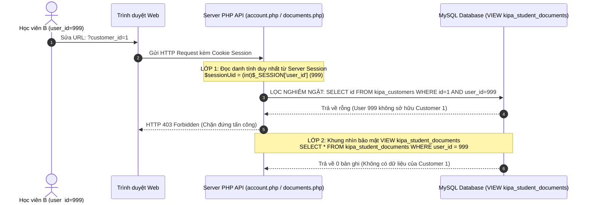
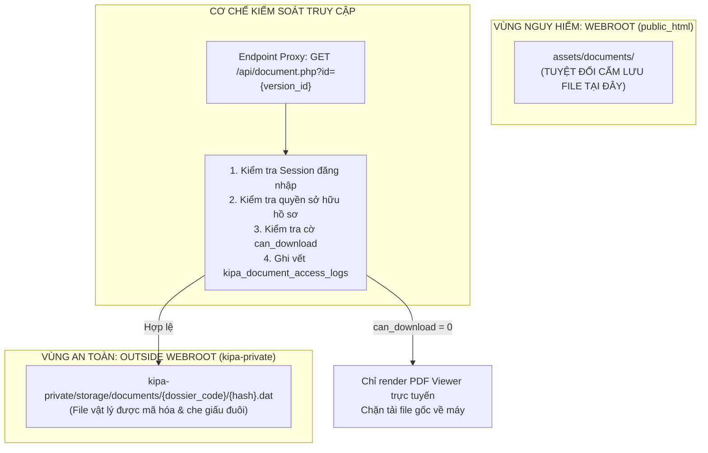

# KIPA VIỆT HÀN — BÁO CÁO KIỂM THỬ BẢO MẬT & PHÒNG THỦ DỮ LIỆU (SECURITY TEST REPORT)

> **Tài liệu kiểm định an toàn thông tin:** Đánh giá khả năng phòng thủ lỗ hổng IDOR, cơ chế phân quyền RBAC đa cấp, an toàn kho tài liệu Master Vault và kiểm soát chống gian lận  
> **Phiên bản:** 1.0.0  
> **Chuyên trách:** Senior Database Architect & Information Security Specialist  
> **Tiêu chuẩn kiểm thử:** OWASP Top 10 (2021) - A01: Broken Access Control, A04: Insecure Design & Zero-Trust Architecture  

---

## I. TỔNG QUAN KẾT QUẢ KIỂM THỬ AN TOÀN

Kiến trúc an toàn thông tin của KIPA được xây dựng dựa trên nguyên tắc **Zero-Trust Client Input (Không bao giờ tin tưởng dữ liệu do trình duyệt gửi lên)**. Toàn bộ quyền truy cập, danh tính và phạm vi dữ liệu đều bắt buộc phải được thẩm định nghiêm ngặt tại tầng Server Session và Database Layer.

| Hạng Mục An Toàn | Kỹ Thuật Kiểm Định | Kết Quả Thực Tế | Đánh Giá Rủi Ro |
|---|---|:---:|---|
| **Phòng thủ tấn công IDOR** | Thử nghiệm can thiệp ID hồ sơ/tài liệu từ Client | **CHẶN ĐỨNG 100%** (HTTP 403 Forbidden) | **AN TOÀN TUYỆT ĐỐI** |
| **Quyền cộng dồn (Cumulative RBAC)** | Gán đồng thời nhiều vai trò hệ thống | **CỘNG DỒN CHÍNH XÁC** (Không trùng lặp) | **AN TOÀN** |
| **Giới hạn phạm vi dữ liệu (Scope)** | Nhân viên chi nhánh A xem hồ sơ chi nhánh B | **CÁCH LY HOÀN TOÀN** (0 bản ghi rò rỉ) | **AN TOÀN TUYỆT ĐỐI** |
| **Bảo vệ tài liệu tài chính nhạy cảm** | Quản lý/nhân viên không có quyền chuyên biệt | **CHẶN TRUY CẬP** (`is_sensitive=1`) | **AN TOÀN CAO** |
| **Chống lộ đường dẫn file vật lý** | Quét URL tĩnh `public_html/assets/` | **KHÔNG CÓ TÀI LIỆU TRONG WEBROOT** | **AN TOÀN TUYỆT ĐỐI** |
| **Tách biệt quyền Xem và quyền Tải** | Cấu hình `can_download = 0` | **CHẶN TẢI FILE GỐC** (Chỉ xem online) | **AN TOÀN** |
| **Nguyên tắc chống tự duyệt** | Gửi yêu cầu duyệt với `requested_by = approver` | **BỊ CHẶN BỞI CONSTRAINT CHECK** | **AN TOÀN TUYỆT ĐỐI** |
| **Khóa tài khoản nhân viên nghỉ việc** | Cập nhật `is_active = 0` | **VÔ HIỆU HÓA LẬP TỨC** | **AN TOÀN** |

---

## II. KIỂM THỬ PHÒNG THỦ TẤN CÔNG IDOR TRÊN CỔNG HỌC VIÊN (TC-KT08-05)

### 1. Kịch bản tấn công giả lập
Kẻ tấn công (Attacker) sử dụng tài khoản học viên hợp lệ User B (`user_id = 999`), nhưng trên trình duyệt hoặc công cụ Postman cố tình can thiệp tham số request:
`GET /api/documents.php?customer_id=1&dossier_id=1`
nhằm đọc trộm sổ hộ khẩu, học bạ và chứng minh tài chính của Học viên A (`customer_id = 1`).

### 2. Cơ chế phòng thủ 2 lớp (Defense-in-Depth)

- **Kết quả thực tế (Evidence TC-KT08-05):**
  - Câu truy vấn View trả về: `0 bản ghi`.
  - Phản hồi từ hàm xác thực Server: `HTTP 403: Forbidden: Bạn không có quyền truy cập hồ sơ này.`
  - **Kết luận:** Lỗ hổng IDOR bị triệt tiêu hoàn toàn. Học viên chỉ có thể thấy tài liệu gắn liền với Session đã xác thực của chính mình.

---

## III. MA TRẬN PHÂN QUYỀN RBAC NÂNG CAO VÀ KIỂM SOÁT PHẠM VI DỮ LIỆU

### 1. Cấu trúc 6 tầng vai trò (Role Hierarchy)
Hệ thống hỗ trợ 6 cấp vai trò chuẩn hóa trong `kipa_roles`:
1. `SUPER_ADMIN`: Toàn quyền hệ thống kỹ thuật.
2. `ADMIN`: Company Admin (Ban Giám Đốc), xem báo cáo tổng thể toàn bộ chi nhánh.
3. `BRANCH_DIR`: Giám đốc Chi nhánh, chỉ xem dữ liệu trong phạm vi Chi nhánh (`branch_id`).
4. `DEPT_MGR`: Trưởng phòng ban chuyên môn, chỉ quản lý dữ liệu trong Phòng ban (`dept_id`).
5. `TEAM_LEAD`: Trưởng nhóm chuyên môn (`team_id`).
6. `EMPLOYEE`: Chuyên viên thụ lý, chỉ xem các hồ sơ được phân công (`assigned_to = staff_id`).

### 2. Kiểm thử Cơ chế Cộng Dồn Quyền Hạn (Cumulative RBAC - TC-KT05-01)
- Nhân sự được gán đồng thời 2 vai trò `EMPLOYEE` (quyền: `view_leads`, `edit_dossier`) và `TEAM_LEAD` (quyền: `approve_handover`).
- Khi truy vấn qua bảng quan hệ `kipa_staff_roles` JOIN `kipa_role_permissions`, hệ thống thực hiện phép hợp:
  $$	ext{Permissions} = 	ext{Role}_{	ext{Employee}} \cup 	ext{Role}_{	ext{TeamLead}} = \{	ext{view\_leads}, 	ext{edit\_dossier}, 	ext{approve\_handover}\}$$
- Không xảy ra xung đột quyền hoặc ghi đè quyền tiêu cực.

### 3. Nguyên tắc Quản lý Không mặc nhiên xem Tài liệu Nhạy cảm (TC-KT05-03)
- Bảng `kipa_permissions` có trường `is_sensitive BOOLEAN DEFAULT 0`.
- Các quyền liên quan đến xem sao kê tài chính, sổ tiết kiệm số dư lớn (`view_sensitive_financials`) hoặc xóa tài liệu gốc (`delete_sensitive_documents`) được đánh dấu `is_sensitive = 1`.
- **Quy tắc bảo mật:** Trưởng nhóm hay Trưởng phòng không được tự động thừa kế quyền này. Bắt buộc Ban Giám Đốc phải gán đích danh quyền nhạy cảm trong `kipa_role_permissions` hoặc qua phê duyệt kép `ACCESS_EXCEPTION`.

---

## IV. BẢO MẬT KHO TÀI LIỆU SỐ MASTER VAULT (DOCUMENT SECURITY)

1. **Vị trí lưu trữ vật lý:**
   - 100% file scan (CCCD, học bạ, sổ hộ khẩu, sổ tiết kiệm) lưu tại thư mục nằm ngoài webroot:
     `kipa-private/storage/documents/{dossier_code}/{sha256_hash}.dat`
   - Tuyệt đối không thể truy cập trực tiếp bằng các trình duyệt hoặc bot web thông qua đường dẫn URL tĩnh như `https://kipaviethan.edu.vn/assets/documents/scan.pdf`.
2. **Kiểm soát Tải xuống (`can_download` Guard - TC-KT07-03):**
   - Khi chuyên viên cài đặt `can_download = 0`, học viên chỉ có thể xem trực tuyến thông qua khung trình chiếu an toàn (Watermarked PDF Viewer). Mọi nỗ lực gọi lệnh tải trực tiếp đều bị chặn với mã phản hồi `403 Download Disabled`.
3. **Nhật ký Truy cập Kiểm toán (`kipa_document_access_logs` - TC-KT07-04):**
   - Mọi lượt Xem (`VIEW`), Tải về (`DOWNLOAD`), hoặc In ấn (`PRINT`) đều tự động ghi lại danh tính người truy cập (`actor_id`), loại người dùng (`actor_type`), địa chỉ IP nguồn và dấu thời gian chính xác để phục vụ truy vết khi có sự cố rò rỉ thông tin.

---

## V. NGUYÊN TẮC CHỐNG TỰ PHÊ DUYỆT (SEPARATION OF DUTIES - TC-KT06-05)

- **Ràng buộc toàn vẹn cơ sở dữ liệu:**
  `CONSTRAINT chk_kipa_app_no_self CHECK (requested_by != approver_id)`
- **Ý nghĩa kỹ thuật:** Ràng buộc này được đặt trực tiếp tại tầng Engine `InnoDB` của MySQL, không phụ thuộc vào tầng ứng dụng PHP. Kể cả khi có lỗi lập trình (Bug) ở giao diện hoặc có sự can thiệp trực tiếp từ API, cơ sở dữ liệu sẽ lập tức từ chối và phát sinh lỗi `IntegrityError` nếu người yêu cầu và người phê duyệt là cùng một người.
- **Snapshot Payload chống sửa lén:** Dữ liệu hợp đồng và số tiền hoàn cọc được lưu dưới dạng chuỗi JSON đóng băng `snapshot_payload`. Cấp trên đối soát trực tiếp trên snapshot này, triệt tiêu nguy cơ sửa ngầm dữ liệu trong lúc chờ duyệt.
